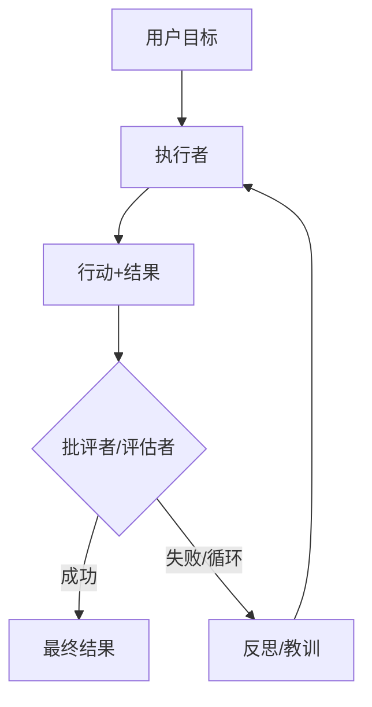

# 推理循环：ReAct及更远

推理循环定义了智能体的控制流。虽然**ReAct**是2023年的基线，但当前系统使用更复杂的模式，如**计划与解决**、**自我反思**和在推理原生模型之上运行的**推理时扩展**。

## 目录

- [循环的演进](#the-evolution-of-the-loop)
- [ReAct：经典模式](#react-reasoning--acting)
- [自我反思循环](#self-reflexion-loops)
- [计划与解决](#plan-and-solve)
- [流程工程（LangGraph模式）](#flow-engineering-langgraph)
- [面试问题](#interview-questions)
- [参考资料](#references)

---

## 循环的演进

| 时代 | 模式 | 核心哲学 |
|-----|---------|-----------------|
| **2023** | ReAct | 交替思考与行动。 |
| **2024** | 反思 | 评估错误并重试。 |
| **2025** | 系统2循环 | 使用隐藏CoT实现可靠的多步逻辑。 |
| **2026** | 工程化框架循环 | 在工具调用之间穿插思考，框架拥有终止、验证和预算的控制权（参见[循环工程](12-loop-engineering.md)）。 |

---

## ReAct：推理+行动

90%智能体的基础循环：
1. **思考**："我需要找到X。"
2. **行动**：`search_engine("X")`
3. **观察**："X在Y处。"
4. **重复**。

**批评**：ReAct很脆弱。如果搜索返回"无结果"，一个天真的ReAct智能体往往会再次尝试相同的搜索。现代循环注入**"负面约束"**（例如，"不要尝试我们已经看过的搜索结果"）。

---

## 自我反思循环

反思为循环增加了一个**"批评者"**步骤。

**益处**：通过将这些"反思"存储在短期记忆中，智能体在当前会话中构建了一个"心理地图"，记录什么不起作用。

---

## 计划与解决

智能体不是一次决定一步（贪心方法），而是首先创建一个**静态计划**，然后执行它。

1. **规划器**："我将先做A，然后做B，然后做C。"
2. **执行器**：执行步骤。
3. **重新规划器**：如果步骤B失败，触发完整重新规划而不是局部修复。

**为什么？**：规划减少"随机错误"。通过承诺一条路径，模型不太可能被嘈杂的工具结果分散注意力。

---

## 流程工程（LangGraph）

现代智能体系统已从"聊天界面"转向**"状态机"**。

- **循环图**：不是线性序列，我们定义一个图，模型可以多次循环回到"清理"节点或"验证"节点。
- **微型智能体**：图中的每个节点都是一个专门的"提示"或"工具"。

**关键细微之处**："智能体"不再只是LLM；智能体是**图执行引擎**。

---

## 面试问题

### 问：何时使用"推理循环"（ReAct）与"计划与解决"架构？

**优秀回答：**
我为**探索性**任务选择**ReAct**，其中环境不可预测（例如，浏览一个您还不知道URL结构的新网站）。智能体需要对每个观察做出反应。我为**可预测**但复杂的工作流选择**计划与解决**（例如，从5个已知API生成财务报告）。规划防止模型"漫游"，并允许更好地并行化彼此不依赖的步骤。

### 问：什么是"推理时扩展"，它与智能体循环有什么关系？

**优秀回答：**
推理时扩展（由OpenAI的o1在2024年推广）指的是在响应生成期间花费更多计算资源，而不仅仅是在训练期间。在当前API中，它表现为**力度**设置：GPT-6 Astra提供从低到最大的五个级别，而Claude Opus 5.5和Fable 5.1通过力度参数调整自适应思考。在智能体环境中，更多思考意味着模型在承诺行动之前权衡替代方案，这可以减少"现实世界"工具调用的数量和失败率。在面试中，我会分开说两件事。首先，供应商没有说他们的推理模型在内部运行显式树搜索；如果我想要**搜索树**（最佳N选、带验证器的MCTS），我会在框架中构建它们，在那里我可以看到并评分分支。其次，力度是我按步骤调整的成本和延迟旋钮，因此我以高力度运行规划器，以低力度运行常规执行步骤，而不是为每个工具调用支付最大思考成本。

---

## 参考资料
- Yao et al. "ReAct：在语言模型中协同推理与行动"（2022）。https://arxiv.org/abs/2210.03629
- Shinn et al. "反思：带口头强化学习的语言智能体"（2023）。https://arxiv.org/abs/2303.11366
- Wang et al. "计划与解决提示"（2023）。https://arxiv.org/abs/2305.04091

---

*下一篇：[工具使用与模型上下文协议（MCP）](03-tool-use-and-mcp.md)*
