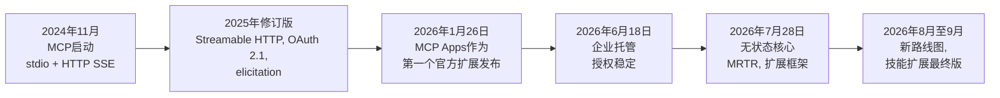
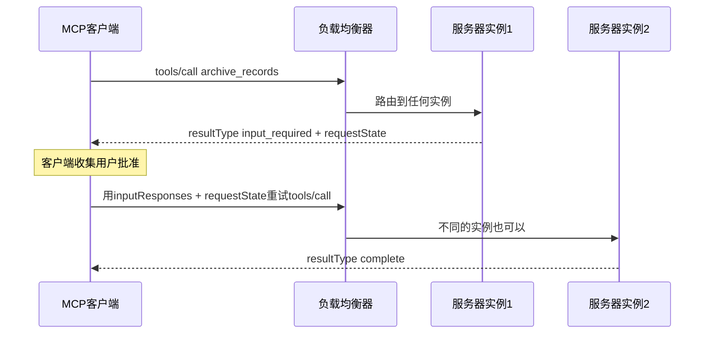
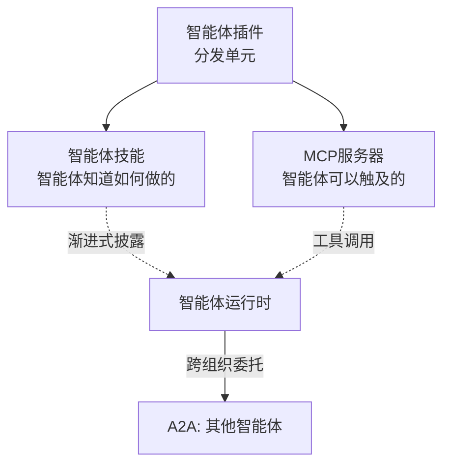
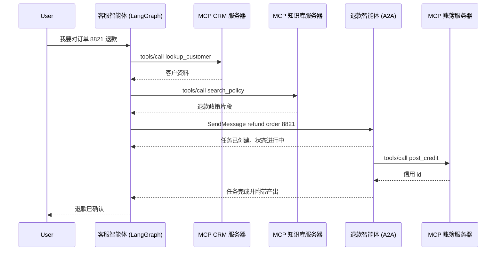
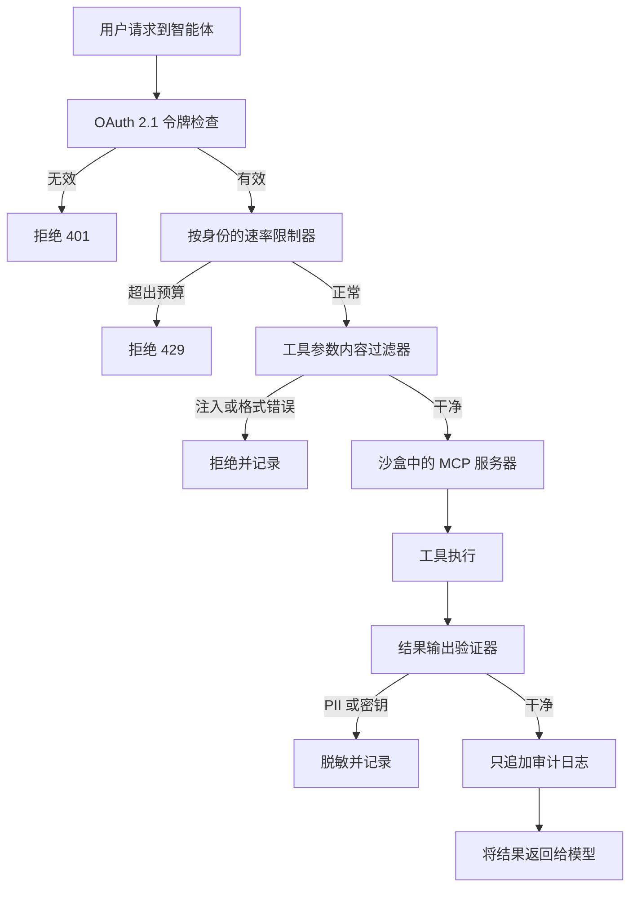

# 工具使用与MCP

工具是智能体的"双手"。行业已标准化为**模型上下文协议（MCP）**，它用单一通信层替代了碎片化的自定义工具定义，该层可在本地通过stdio或远程通过Streamable HTTP运行。Streamable HTTP和OAuth 2.1授权在2025年规范修订中引入（评论通常称其为"MCP 2.0"，但没有规范版本携带该名称，2026年7月的SDK 2.x主要版本是独立的编号），而**2026-07-28修订版**将协议核心重建为无状态，这是MCP自推出以来最大的 overhaul（参见下面的[无状态重写](#mcp-2026-07-28-the-stateless-rewrite)）。与此同时，**智能体到智能体（A2A）**补充了MCP的工具访问层与智能体协调，自2026年8月起，两个协议都隶属于同一个Linux Foundation伞下组织——Agentic AI Foundation。

## 目录

- [工具使用机制](#the-tool-use-mechanism)
- [模型上下文协议（MCP）](#model-context-protocol-mcp)
- [定义高精度工具](#defining-high-precision-tools)
- [MCP与OpenAI函数调用](#mcp-vs-openai-function-calling)
- [流式工具调用](#streaming-tool-calls)
- [2025年修订：Streamable HTTP和认证](#the-2025-revisions-streamable-http-and-auth)
- [MCP 2026-07-28：无状态重写](#mcp-2026-07-28-the-stateless-rewrite)
- [MCP扩展与生态系统（2026年10月）](#mcp-extensions-and-ecosystem-october-2026)
- [智能体插件](#agent-plugins)
- [智能体到智能体协议（A2A）](#agent-to-agent-protocol-a2a)
- [协议全景：工具、智能体和支付](#the-protocol-landscape-tools-agents-and-payments)
- [A2A v1.0和MCP生产环境](#a2a-v10-and-mcp-in-production)
- [计算机使用工具（Anthropic）](#computer-use-tools-anthropic)
- [Context7：实时代档MCP](#context7-live-documentation-mcp)
- [面试问题](#interview-questions)
- [参考资料](#references)

---

## 工具使用机制

工具使用发生在3步循环中：
1. **模式呈现**：模型被提供工具的JSON模式。
2. **意图与提取**：模型输出一个"调用"（例如，`{"tool": "get_weather", "args": {"city": "Tokyo"}}`）。
3. **执行与语境化**：系统运行函数并将结果反馈到提示中。

**细微之处**：生产堆栈不再将工具定义"硬编码"到系统提示中。它们使用**动态清单**，仅根据用户意图获取必要的工具。

2026年三个影响框架代码的供应商端变化：

- **强制工具使用在最新的Claude模型上已消失。** Fable 5.1、Mythos 5.1、Opus 5.5和Sonnet 5.5对`tool_choice`为`any`或`tool`返回HTTP 400；只剩下`auto`和`none`。旧的"强制工具调用以获取JSON"的提取模式必须改为`auto`加严格工具使用，或结构化输出。
- **工具可以在对话中途更改而不会丢失缓存。** Anthropic的`inline-tools-2026-09-15`测试版（9月22日）允许在对话中途的系统消息内定义、替换或移除工具，而不会使提示缓存失效，并且可以在`mcp_tool_listing`块中固定获取的MCP工具列表，因此服务器无法在会话中途交换定义。
- **在GPT-6 Astra上的工具调用需要Responses API**，而且Astra放弃了`temperature`、`top_p`和logprobs，因此调整了采样或读取logprobs进行工具路由的框架需要另一种机制。

---

## 模型上下文协议（MCP）

由Anthropic开发（2024年11月发布），现在是Anthropic、OpenAI、Google、Microsoft和AWS之间通用的工具集成标准，MCP允许模型与数据和工具交互，无论它们位于何处。管理权于2025年12月移交给Linux Foundation的Agentic AI Foundation。

- **MCP客户端**：AI应用程序（例如，您的智能体代码）。
- **MCP服务器**：一个独立进程，暴露工具（函数）、资源（数据）和提示（模板）。
- **通信**：使用stdio（本地）或Streamable HTTP（远程）上的JSON-RPC。

### 为什么选择MCP？
- **安全性**：工具在它们自己的进程中运行，而不是在模型逻辑中。
- **可移植性**：编写一次"Postgres工具"，在Claude、GPT或Llama中使用。
- **可发现性**：标准化的`tools/list`、`resources/read`和`prompts/list`方法，以及2026-07-28修订版强制要求的`server/discover` RPC。

---

## 定义高精度工具

生产级工具必须包括：

1. **严格类型验证**：使用Pydantic或Zod在执行调用之前强制执行模式，并打开供应商的严格工具模式，使参数在生成时受模式约束。
2. **详细文档字符串**：描述*何时不*使用该工具。
3. **置信度阈值**：要求模型输出工具调用的`confidence`分数。将其视为路由提示，而不是校准概率。
4. **有意图的、模型可见的错误**：自MCP Python SDK 2.1.0起，处理程序中的意外异常被记录，客户端只看到`Error executing tool <name>`；为模型应该采取行动的消息引发`ToolError`。该默认是正确的（堆栈跟踪会泄露内部信息），但这意味着可操作的错误必须被设计，而不是被泄露。

```python
# MCP Python SDK 2.x: `pip install mcp`现在解析到2.x，FastMCP被重命名为MCPServer。
# 尚未准备好迁移的项目应该固定mcp<2（v1仅接收安全和关键修复）。
from mcp.server import MCPServer

mcp = MCPServer("analytics")

@mcp.tool()
def execute_sql(query: str) -> list[dict]:
    """对分析副本运行一个只读的SELECT。
    不要用于DDL或写入：DROP、DELETE和UPDATE会被
    数据库角色拒绝，而不仅仅是这个文档字符串。"""
    ...  # 参数化，强制执行行限制，在只读角色下运行
```

---

## MCP与OpenAI函数调用

| 特性 | OpenAI原生 | MCP |
|---------|---------------|-----|
| **耦合度** | 高（OpenAI特定） | 低（无关） |
| **传输** | API主体中的JSON | JSON-RPC（本地/远程） |
| **数据访问** | 没有原生数据"资源" | 原生`Resources`支持 |
| **最适合** | 原型设计 | 企业编排 |

这种比较不像表格暗示的那样非此即彼。OpenAI的Responses API、其Agents SDK和托管Agents API（2026年9月10日公测版）都使用远程MCP服务器，因此函数调用是供应商API内部的线格式，而MCP是工具如何打包、保护和访问的方式。

---

## 流式工具调用

前沿模型支持**部分工具推测**。
系统不再等待完整JSON生成，而是在流中看到工具名称和关键ID时立即开始"预取"工具结果。这将感知到的延迟减少**400-800毫秒**。

---

## 2025年修订：Streamable HTTP和认证

MCP规范修订是日期标记的，不是编号的：2024-11-05、2025-03-26、2025-06-18、2025-11-25和2026-07-28（当前）。**2025-03-26**修订版（2025年3月）引入了使远程MCP实用的两项更改，而2025-06-18修订版将认证模型硬化为今天使用的形状。"MCP 2.0于2026年3月批准"是对相同更改的常见误标，晚了一年。

### 1. Streamable HTTP传输
启动时代的MCP在本地使用stdio，或远程使用带有单独Server-Sent Events通道的HTTP。**Streamable HTTP**用单一端点替代了HTTP+SSE：客户端向它POST JSON-RPC消息，服务器用普通JSON响应回答，或在需要发送多条消息时用SSE流回答。

```
[MCP客户端] ──── POST /mcp (JSON-RPC) ────→ [MCP服务器]
             ←─── JSON响应，或SSE流 ───
```

- 使MCP服务器能够作为云微服务部署（不仅仅是本地进程）
- stdio仍然是本地传输；HTTP+SSE自2025-03-26起已被弃用，2026-07-28修订版将其移至规范的正式弃用轨道

### 2. OAuth 2.1授权
远程MCP服务器可以要求OAuth 2.1和PKCE。自2025-06-18起，MCP服务器是一个OAuth**资源服务器**：它通过受保护资源元数据（RFC 9728）广告其授权服务器，客户端必须发送RFC 8707 `resource`参数，因此每个令牌都受限于一个服务器的受众。没有令牌的请求会收到一个挑战，告诉客户端从哪里开始：

```http
HTTP/1.1 401 未授权
WWW-Authenticate: Bearer resource_metadata="https://mcp.example.com/.well-known/oauth-protected-resource",
                         scope="files:read"
```

这使企业MCP服务器具有细粒度的、按服务器的访问控制。2025-11-25修订版增加了客户端ID元数据文档作为推荐的注册机制，以及增量范围同意，服务器用HTTP 403 `insufficient_scope`回答，附带它需要的范围（升级）。2026-07-28修订版随后弃用了动态客户端注册，转而支持这些元数据文档，并使客户端在授权服务器发送时验证RFC 9207 `iss`参数，两者都在下面涵盖。

---

## MCP 2026-07-28：无状态重写

2026年7月28日，MCP项目最终确定了规范修订版**2026-07-28**，这是MCP自推出以来最大的协议全面修订，经过十周的发布候选冻结。头条新闻是：**协议核心现在是无状态的**。`initialize`握手和`Mcp-Session-Id`头部已消失；每个请求在`_meta`中携带协议版本和客户端能力，服务器在结果`_meta`中识别自己。跨调用状态转移到作为普通工具参数传递的显式服务器铸造句柄中。实际结果是，远程MCP服务器现在可以作为水平扩展的部署在普通轮询负载均衡器后面运行，零共享会话状态，这以前需要粘性会话或共享会话存储。

### MCP如何到达这里



### MCP的三代比较

| 维度 | 启动（2024年11月） | Streamable HTTP时代（2025年修订版） | 2026-07-28修订版 |
|-----------|-------------------|--------------------------------------|---------------------|
| **会话模型** | 有状态`initialize`握手 | 有状态，`Mcp-Session-Id`通过Streamable HTTP | 无状态；版本和能力在每次请求的`_meta`中携带 |
| **传输** | stdio, HTTP+SSE | 增加Streamable HTTP | 强制`Mcp-Method`/`Mcp-Name`路由头部的Streamable HTTP；HTTP+SSE正式弃用 |
| **服务器发起的请求** | 采样、根（服务器推送） | 增加elicitation | 已移除；由多轮往返请求替代（客户端带状态重试） |
| **通话中用户输入** | 无 | `elicitation/create`推送 | `input_required`结果+客户端用`requestState`重试 |
| **长时间运行的工作** | 无 | 实验性 | 任务官方扩展（基于轮询的句柄） |
| **服务器渲染UI** | 无 | MCP Apps作为扩展发布（2026年1月） | MCP Apps并入正式扩展框架 |
| **认证** | 无标准化 | OAuth 2.1 + PKCE, 动态客户端注册；CIMD和升级范围同意在2025-11-25中增加 | OAuth加固：RFC 9207 `iss`验证、发行人绑定凭证、CIMD替代DCR；EMA扩展用于企业IdP |
| **列表缓存** | 无 | 无 | 列表和读取结果需要`ttlMs`+`cacheScope`；确定性工具排序以命中提示缓存 |
| **流恢复** | 无 | SSE `Last-Event-ID`可恢复性 | 已移除；客户端重新发出请求，持久工作使用任务 |
| **水平扩展** | 单进程 | 负载均衡器后的粘性会话 | 任何实例服务任何请求；无共享状态 |

### 多轮往返请求（MRTR）

服务器发起的请求模式（`elicitation/create`、`sampling/createMessage`、`roots/list`）已被移除。当服务器需要通话中用户输入时，它返回一个带有`resultType: "input_required"`、`inputRequests`数组和不透明`requestState`块的结果；客户端收集输入并用附带的`inputResponses`重试原始请求。因为状态在重试中携带，负载均衡器后面的任何服务器实例都可以恢复中断的调用。这就是人机协同批准门与无状态水平扩展兼容的原因。



所有结果现在携带必需的`resultType`字段（`complete`或`input_required`；任务等扩展添加更多值）；来自缺少该字段的旧服务器的结果被视为`complete`。

### 什么已被弃用或移除

该修订版还采用了正式的功能生命周期（活跃、已弃用、已移除），最低十二个月的弃用窗口和公开的弃用功能注册表。对于此修订版中新弃用的功能（根、采样、日志记录、DCR），最早移除日期为2027年7月28日；早在2025年3月就被弃用的HTTP+SSE运行在更早的时钟上。

| 功能 | 2026-07-28中的状态 | 迁移到 |
|---------|----------------------|------------|
| `initialize`握手, `Mcp-Session-Id` | 已移除 | 每次请求的`_meta`中的版本和能力；用于探测的`server/discover` RPC |
| `elicitation/create`, `sampling/createMessage`, `roots/list` | 已移除 | 多轮往返请求 |
| SSE流可恢复性（`Last-Event-ID`） | 已移除 | 重新发出请求；持久工作的任务扩展 |
| 根 | 已弃用 | 通过工具参数、资源URI或服务器配置传递目录 |
| 采样 | 已弃用 | 直接调用LLM供应商API |
| 日志记录 | 已弃用 | stderr（stdio）或OpenTelemetry |
| HTTP+SSE传输 | 正式弃用 | Streamable HTTP |
| 动态客户端注册（RFC 7591） | 已弃用 | 客户端ID元数据文档（客户端ID是托管客户端元数据的URL） |

RPC机制（`elicitation/create`、`sampling/createMessage`、`roots/list`）已从核心协议中移除，而它们服务的功能被弃用并带有迁移路径，这就是为什么上面出现两种类型的行。

两个较小但设计相关的传输变化：`Mcp-Method`和`Mcp-Name` HTTP头部现在在Streamable HTTP POST上是强制的，因此负载均衡器、网关和WAF可以在不解析JSON-RPC主体的情况下路由和过滤MCP流量；而且列表结果（`tools/list`、`prompts/list`、`resources/list`）必须声明`ttlMs`和`cacheScope`，为缓存工具目录给客户端一个原则性的答案。

### 扩展框架

核心现在故意保持小巧；其他一切都是**扩展**，通过反向DNS ID识别，独立于核心规范进行版本控制，并通过SEP过程中的扩展轨道进行管理。官方扩展包括：

| 扩展 | 状态 | 功能 |
|-----------|--------|--------------|
| **任务** (`io.modelcontextprotocol/tasks`) | 官方；重新设计基于轮询的生命周期，由AWS贡献 | 工具调用可以用任务句柄回答；客户端轮询`tasks/get`，用`tasks/update`推送任务中输入，用`tasks/cancel`取消。对于超出请求寿命的工作的标准答案。 |
| **MCP Apps** | 自2026年1月26日起官方 | 工具声明一个`ui://`模板；主机在沙箱iframe中渲染它（无DOM访问，默认拒绝CSP），UI到主机的通信是通过postMessage携带的JSON-RPC，UI触发的操作通过相同的工具调用同意路径。由Claude、ChatGPT、VS Code、Goose和Microsoft 365 Copilot等渲染。 |
| **企业托管授权（EMA）** | 自2026年6月18日起稳定 | 组织通过其IdP集中配置MCP服务器访问：交换OIDC或SAML断言（RFC 8693）以获取ID-JAG，JWT承载授权（RFC 7523）将其交易为MCP访问令牌，无需每用户同意屏幕。Okta是第一个支持的IdP；Claude和VS Code在发布时即支持。ID-JAG授权本身仍然是IETF OAuth工作组的互联网草案（-04），不是RFC，因此预期会有线路级变化。 |

### 迁移检查清单

- 移除`initialize`/会话ID逻辑；在`_meta`中发送版本和能力，并实现`server/discover` RPC（现在是必须的）。
- 将elicitation和采样流转换为MRTR：返回`input_required`并附带`requestState`，接受带有`inputResponses`的重试。
- 将任何跨调用状态转移到作为工具参数传递的显式句柄中，或采用任务扩展。
- 发出`Mcp-Method`/`Mcp-Name`头部，在列表结果上声明`ttlMs`/`cacheScope`，并按确定性顺序返回工具。
- 规划从DCR到客户端ID元数据文档的认证迁移；按RFC 9207验证`iss`，并且永远不要跨发行人重用客户端凭证。
- 预算实际工作：维护者自己警告自定义实现面临显著的升级工作。

来源：modelcontextprotocol.io/specification/2026-07-28/changelog, blog.modelcontextprotocol.io

---

## MCP扩展与生态系统（2026年10月）

本章跟踪到2026年5月的路线图项目已基本发货。截至2026年10月的状态：

| 路线图项目（2026年5月框架） | 状态（2026年10月） |
|---------------------------------|--------------------|
| 传输可扩展性/无状态核心 | **已发货** 在2026-07-28修订版中（参见[无状态重写](#mcp-2026-07-28-the-stateless-rewrite)）。8月22日路线图更进一步：Streamable HTTP作为单一绑定，通过stdin/stdout为本地服务器服务 |
| MCP Apps（服务器渲染UI） | **已发货** 2026年1月26日作为第一个官方扩展；由Claude、ChatGPT、VS Code、Goose和Microsoft 365 Copilot等渲染。Apps SDK在ext-apps 2.0.0（9月8日）中移至v2 TypeScript包，线路协议未变，因此2.x视图在1.x主机中运行，2.x主机渲染1.x视图：SDK级破坏而不破坏线路，这正是扩展框架的设计目的 |
| 任务扩展（长时间运行的工作） | **已发货** 作为`io.modelcontextprotocol/tasks`在2026-07-28修订版中，围绕基于轮询的任务句柄重新设计，但扩展仓库仍只有预发布标签（v0.2.0到v0.2.2，9月23日至30日），因此将界面视为稳定中。8月22日路线图目标将任务（SEP-2663）最终纳入核心协议，在组合审查之后，使任务、订阅和进度通知共享一个生命周期、取消模型和错误表面 |
| 企业认证 | **已发货** 2026年6月18日作为企业托管授权扩展（Okta第一个IdP；Claude和VS Code在发布时）。下一个是智能体身份：DPoP发送者约束令牌（SEP-1932）和工作负载身份联邦（SEP-1933）仍然是开放草案，尽管TypeScript客户端2.1.0已经发货DPoP |
| MCP服务器卡片（连接前发现） | 仍然是实验性的（SEP-2127，审查中）。卡片现在通过`GET <streamable-http-url>/server-card`服务，客户端通过域名AI目录中的条目找到它们，位于`/.well-known/ai-catalog.json`，这是由Linux Foundation下的Agent Card工作组维护的跨协议索引，还列出了A2A智能体卡片和Claude Code插件。与核心`server/discover` RPC不同 |
| MCP注册表 | 仍在预览中（`registry.modelcontextprotocol.io`），API冻结在v0.1；GA时间未宣布。v1.8.1版本（8月6日）修复了GitHub Pages组织命名空间接管 |
| 通过MCP的技能（新） | **最终版** 2026年9月13日作为`io.modelcontextprotocol/skills`扩展（SEP-2640）；参见下文 |

**发现现在有两个层次值得保持清晰：** 通过域名的AI目录指向服务器卡片的连接前发现（实验性；供给注册表、爬虫和允许列表）与协议内的`server/discover` RPC（自2026-07-28起强制核心；供给版本协商）。因为同一个目录文档索引MCP服务器和A2A智能体，企业平台可以从一个地方允许列表两种类型的远程能力，但将其作为方向呈现，而不是标准。

### 8月22日路线图优先事项

核心维护者在2026年8月22日发布了一份6至12个月的路线图，对五个领域进行加速SEP审查。未给出下一个规范修订版的日期。

| 优先领域 | 对构建者的意义 |
|---------------|----------------------------|
| **智能体消息原语** | 服务器发起的事件和Webhook（触发器和事件WG）；任务、订阅和进度通知收敛于一个生命周期 |
| **HTTP原生传输** | 到处一个绑定（Streamable HTTP），包括通过stdio为本地服务器服务；缓存从`ttlMs`/`cacheScope`扩展到ETags，包括版本化的工具调用结果 |
| **智能体身份和企业安全** | 一个智能体身份WG（组建中）来最终确定DPoP和基于工作负载身份联邦、ID-JAG和RFC 8693令牌交换的委托身份模型，与IETF OAuth和WIMSE组协调；证明人类是否存在（交互式客户端 vs 无头智能体）正在讨论中 |
| **改进的原语** | 重新设计`tools/call`结果形状（返回`content`和`structuredContent`产生分歧的实现）；大型工具目录的实验性服务器端渐进发现机制 |
| **SDK开发者体验** | 正式扩展合同；一个从规范和一致性套件生成Tier 1 SDK和快速入门的实验 |

这设定的两个前瞻性面试问题：具有自己身份的无头智能体如何到达MCP服务器，以及如何在不超过上下文窗口的情况下提供2,000个工具的目录。

### 通过MCP的技能

智能体技能（`SKILL.md`文件夹）于2026年8月19日在Claude API上离开测试版，MCP技能扩展（最终版9月13日）让服务器发布技能，与它们描述的工具相邻，而不是将它们复制到文件系统或插件中。声明它的服务器实现`skills/list`和`skills/get`，技能文件通过普通`resources/read`读取。每个技能条目携带其前言和完整的文件清单，带有每个文件的SHA-256摘要和大小。

主机规则是学习的部分，因为它们回答了"如何阻止远程服务器悄悄更改我的智能体加载的指令"，这是工具拉地毯的技能版本：

- 主机**必须**在使用前验证大小、摘要和前言，并且**必须**将任何持久批准绑定到整个清单，因此更改、添加或删除的文件会撤销批准。
- 主机**不得**预取技能文件，并且**必须**将技能内容视为不可信。
- 技能的`allowed-tools`授权或任何主机端代码执行需要明确的逐技能批准，跨服务器读取需要命名两个服务器的逐调用批准。

采用尚处于早期：Hugging Face的MCP服务器实现了它，MCP Inspector 2.6.0有部分支持，而官方SDK拉取请求在9月下旬仍然开放。技能在其他地方也正在成为版本化的生产工件（AWS在9月30日为其智能体工具包添加了`update-skill`命令），因此给它们与包依赖项相同的固定和更新审查。

**生态系统规模：** SDK下载量每月数亿次。协议本身的7月28日发布帖子引用了Tier 1 SDK每月近5亿次；Anthropic单独报告每月4亿次，全年增长4倍，因此将总数视为数量级而不是精确数字，并在引用前检查指标定义。仅在8月，一个连接器目录就列出了**超过950个MCP服务器**。在7月28日最终发布时，AWS、Cloudflare、Google Cloud、Microsoft和Netlify宣布了启动支持。Microsoft推出了可从Microsoft 365管理中心管理的基于MCP的联邦Copilot连接器，Apple使Xcode成为外部编码智能体的MCP主机，Bloomberg发布了MCP作为其内部智能体工具层的生产案例研究。

**向无状态修订版的迁移是真实的但缓慢的。** 2026年9月的npm下载量：v1 TypeScript SDK（`@modelcontextprotocol/sdk`）约2.319亿次，而`@modelcontextprotocol/core`约3060万次，`@modelcontextprotocol/server`2540万次，`@modelcontextprotocol/client`1910万次。在单一包比较中，v2现在约占v1流量的8%到13%，高于8月中旬的低个位数，而v1仍在增长（截至8月14日的30天内约2.07亿次）。计划一个长期的双版本期：C# SDK v2.2.0（8月13日）添加了一个`HttpServerSessionMode`，让单个端点同时服务2025-11-25有状态客户端和2026-07-28无状态客户端，如果您运营混合客户端的服务器舰队，这是要复制的模式。

SDK主要版本会破坏代码，即使线路协议不会。在Python中，`pip install mcp`自2.0.0（7月28日）以来解析到2.x：`FastMCP`变成了`MCPServer`，单个`Client`替代了v1的传输加`ClientSession`分层，而v1仅获得安全和关键修复，因此导入`FastMCP`的教程在全新安装时会中断。智能体框架在几周内跟进（OpenAI Agents SDK 0.20.0支持两个主要版本；LangChain 1.4.0在协商的协议时代上门控MCP中断路由），这显示了每个框架共享的依赖项中主要版本的爆炸半径。Tier 1 SDK现在是TypeScript、Python、C#、Go、Rust（8月21日晋升）和Ruby（9月28日晋升）；Java是Tier 2，Swift、PHP和Kotlin是Tier 3。一致性套件发布修订版的冻结需求集（截至10月1日为0.2.0-alpha.12）。

**治理**：MCP由Linux Foundation的Agentic AI Foundation（AAIF）管理，现在托管六个项目（MCP、goose、AGENTS.md、agentgateway、A2A和Agent Router，前Envoy AI Gateway），并于8月12日报告了247个成员组织。治理工作组运行贡献者阶梯和委托模型，允许特定领域的工作组在没有完整核心维护者审查的情况下接受SEP（规范增强提案）；2026-07-28修订版添加了正式的扩展轨道，自9月28日起SEP作者必须在打开SEP拉取请求之前与相关工作组或兴趣组讨论提案。AAIF还在9月14日推出了第一个供应商中立的MCP凭证，模型上下文协议助理（MCPA）：250美元，90分钟，对齐2026-07-28，考试内容的24%是安全和治理。

来源：modelcontextprotocol.io（规范、路线图、扩展），blog.modelcontextprotocol.io，github.com/modelcontextprotocol，aaif.io

---

## 智能体插件

MCP标准化了智能体如何到达工具。**智能体插件**于2026年8月6日达到1.0.0，标准化了如何将一揽子能力交付给智能体。它是一个供应商中立的打包格式，由来自Amazon、Cursor、Microsoft、OpenAI和Vercel的技术指导委员会管理，GitHub于8月12日在VS Code、Copilot CLI、Copilot SDK和Copilot应用上普遍提供。1.0.0仍然是唯一发布的版本；1.1.0工作草案于8月19日开放，提出了命名空间技能发现、可移植显示名称和图标以及逐服务器MCP扩展数据等提案，所有这些都仍在下面描述的技能加MCP边界内。

插件是一个目录：

```
my-plugin/
├── plugin.json          # 必需清单
├── skills/              # 可选：智能体技能（SKILL.md文件）
│   └── code-review/
│       └── SKILL.md
├── mcp.json             # 可选：MCP服务器声明
└── com.example.client/  # 可选：客户端特定额外内容，命名空间
```

`mcp.json`模式支持三种服务器形状（带命令、参数和env的stdio；Streamable HTTP；和SSE），并保留两个环境变量，`PLUGIN_ROOT`和`PLUGIN_DATA`，客户端在加载时注入。

值得研究的设计决策是规范**拒绝**标准化的内容。只有两种组件类型是可移植的：技能和MCP服务器。命令、钩子、子智能体、规则和LSP服务器保持客户端特定，除非在命名空间目录中携带。这使可移植表面保持足够小，使插件真正到处运行，并将快速变化的客户端特定部分推入命名空间，在那里它们不能破坏互操作性。

### 三层如何配合



| 层 | 标准化 | 单元 | 治理 |
|-------|--------------|------|------------|
| **智能体技能** (`SKILL.md`) | 智能体应用的程序和领域知识 | 带前言的文件夹加可选脚本和资源；也可以通过MCP技能扩展远程服务 | agentskills.io |
| **MCP** | 访问工具、数据和资源 | 通过stdio或Streamable HTTP讲JSON-RPC的服务器 | Linux Foundation, Agentic AI Foundation |
| **智能体插件** | 上述两者的分发和安装 | 带`plugin.json`的目录 | 智能体插件TSC |
| **A2A** | 跨供应商或组织边界的智能体之间的委托 | 由智能体卡片描述的智能体端点（签名可选） | Linux Foundation, Agentic AI Foundation（自2026年8月起） |

对平台团队的实际影响：企业管理现在有一个控制点。GitHub重用现有的`managed-settings.json`，因此插件安装、市场访问和MCP服务器允许列表都通过同一文件管理。如果您正在建立内部智能体平台，插件是您审查、签名和分发的单元，而不是单个服务器。

**随之而来的安全警告：** 插件将指令（技能）与能力（MCP服务器）捆绑在一起，因此安装一个更接近安装包而不是添加书签。技能的静态分析有一个难以突破的检测上限，发布的结果显示数据外泄检测率为93%，但自然语言提示注入仅为42%，**主机破坏为0%**，因为破坏性技能使用与合法命令看起来相同的普通shell命令。适应性攻击者更进一步：Pretext攻击（arXiv 2609.39607）通过将载荷从代码转移到自然语言并跨文件分割，逃避了LLM辅助技能扫描器高达97%的时间。像审查依赖项一样审查插件：固定版本、优先选择签名来源，永远不要让插件扩大加载它的智能体的操作表面。

**并验证固定。** Plugin4Shell（AIR Security，2026年9月17日）显示Claude Code、Codex、GitHub Copilot和Gemini CLI安装固定到40位十六进制提交SHA的插件，而不检查检出树是否匹配该固定。Git偏好名称等于SHA的分支，因此在接受哈希形状分支名称的主机上，仓库所有者可以交换已批准的代码，后台更新无需点击即可拉取。Claude Code（2.1.179）和Codex（0.146.0）修复了它；Copilot在披露时还没有修复。控制是在检出后解析工作树中实际存在的提交，并在不匹配时中止。随着框架扩展获得能力，赌注不断上升：Claude Code mods（2.1.287，10月1日）是插件分发的TypeScript函数，可以重写工具调用并批准或拒绝权限请求，Anthropic警告它们不受沙箱保护，因此插件审查现在成为智能体信任边界的一部分。

---

## 智能体到智能体协议（A2A）

Google于2025年4月推出了**Agent2Agent（A2A）**协议，以解决MCP无法解决的问题：**不同供应商的智能体**如何相互通信（不仅仅是与工具）？

### A2A解决什么

MCP定义了智能体如何连接到**工具和数据**。A2A定义了**编排智能体如何将任务委托给专业智能体**，来自不同的供应商或框架，即使它们不共享记忆、工具或上下文。

### 技术基础

- 基于HTTP构建，v1.0中有三种绑定：**JSON-RPC、gRPC和REST**（与MCP相同的Web基础，便于集成）
- 支持企业级认证，与OpenAPI认证方案对等
- **智能体卡片**：JSON元数据文档，描述智能体的能力、技能和端点，通过`GET /.well-known/agent-card.json`服务（不是`agent.json`）。用JWS签名是可选的

### A2A任务生命周期

v1.0方法是`SendMessage`、`SendStreamingMessage`、`GetTask`、`ListTasks`、`CancelTask`和`SubscribeToTask`，带有REST绑定，如`POST /message:send`和`GET /tasks/{id}`。没有`POST /tasks`或`tasks.create`：客户端发送一个**消息**，服务器决定直接回答还是创建一个**任务**。这是面试官探究的设计选择。

```
[客户端智能体] ── SendMessage (POST /message:send) ──→ [远程智能体]
                                                        │ 服务器决定：回复，还是创建任务
               ←── 消息，或任务 {id, state: working} ┘
[客户端智能体] ── SubscribeToTask / GetTask ──→
               ←── 流式状态更新和产物
               ←── 任务完成（最终产物）
```

A2A任务支持具有流式状态更新的长时间运行操作，使其适合跨越数分钟或数小时的企业工作流。

**v1.1添加的内容（未发布）。** `dev-1.1`分支上的工作包括一个单调递增的`Task.generation`字段（2026年8月12日合并）。客户端用它来检测遗漏的事件，用`current_generation`进行长轮询，并用`if_generation_match`进行比较和设置，在不匹配时失败并返回HTTP 412或gRPC `ABORTED`。这是多个客户端安全地操控一个长时间运行的远程任务而不丢失更新的教科书答案。路线图（9月15日）还列出了双向流和一个用于编码框架集成的官方A2A CLI。

### 行业采用

- 在发布时得到50多家技术合作伙伴的支持，包括Atlassian、Salesforce、SAP、LangChain和PayPal
- 于2025年6月捐赠给**Linux Foundation**，并于2026年8月17日作为成长阶段项目被**Agentic AI Foundation**接受，因此MCP和A2A现在共享一个中立基金会；AAIF引用了150多个支持组织以及Google Cloud、Amazon Bedrock AgentCore和Microsoft Azure AI Foundry中的原生A2A支持
- **版本0.3**（2025年7月）增加了gRPC支持、签名智能体卡片和扩展的Python SDK支持。**v1.0.0**于2026年3月12日发货，**v1.0.1**（2026年5月28日）截至2026年10月仍然是最新的规范发布；没有协议v1.2。更高的数字属于SDK：a2a-python 1.2.1（1.2线添加了多副本集群模式）、a2a-js 1.3.0、a2a-java 1.4.0.Final和a2a-go v2.6.0
- NIST于2026年2月启动了"AI智能体标准倡议"，部分是对A2A/MCP势头的回应

来源：github.com/a2aproject/A2A（发布、规范、路线图），aaif.io/blog/a2a-joins-aaif

---

## 协议全景：工具、智能体和支付

在生产企业系统中，多个协议同时在不同层运行：

| 协议 | 层 | 目的 | 管理方 |
|----------|-------|---------|-------------|
| **MCP** | 智能体到工具 | 通用工具和数据访问 | Linux Foundation (Agentic AI Foundation) |
| **A2A** | 智能体到智能体 | 跨供应商智能体委托 | Linux Foundation (Agentic AI Foundation, 自2026年8月起) |
| **ACP** (智能体通信协议) | 智能体通信 | 轻量级异步智能体消息传递（REST） | IBM发起；于2025年8月合并入A2A |

### 它们如何互补

```
┌──────────────────────────────────────────┐
│            企业系统             │
│                                          │
│  ┌─────────┐  A2A   ┌─────────┐         │
│  │ 智能体 A  │◄──────►│ 智能体 B │         │
│  │(供应商 X)│        │(供应商 Y)│        │
│  └────┬─────┘        └────┬─────┘        │
│       │ MCP                │ MCP          │
│  ┌────▼─────┐        ┌────▼─────┐        │
│  │ 数据库工具  │        │ API工具 │        │
│  │ 服务器   │        │ 服务器   │        │
│  └──────────┘        └──────────┘        │
└──────────────────────────────────────────┘
```

**关键见解**：MCP和A2A是互补的，不是竞争的。MCP处理智能体到工具的连接；A2A处理智能体到智能体的协调。生产系统两者都用。

**ACP说明**：IBM发起的智能体通信协议（ACP）团队于2025年8月将其工作合并入A2A，以开发统一的智能体通信标准。新项目应将A2A作为主要的智能体到智能体协议。

### 商业层

执行购买操作的智能体需要第三层能力：验证用户意图、处理结账过程中的阶梯式认证，以及为按量计费工具付费。目前有四项工作在推进，成熟度各不相同：

| 协议 | 覆盖范围 | 状态（2026 年 10 月） |
|----------|--------|-----------------------|
| **UCP**（通用商业协议） | 跨购物、支付和通用垂直领域的发现、购物车和结账 | 版本 v2026-08-25 新增了 Actions 原语，用于处理带外步骤，如供应商无关的 3DS2、付款计划和拆分支付，以及委托身份提供者；住宿预订草案于 9 月 24 日合并 |
| **Agentic Commerce Protocol**（OpenAI 和 Stripe） | 购物车、产品流、订单、认证、MCP | 仍标记为 beta；最新标注日期为 2026-04-17 |
| **AP2**（智能体支付协议，Google） | 证明用户授权的支付授权 | v0.2.0（2026 年 4 月 28 日）；此后无新版本 |
| **x402** | 通过 HTTP 402 状态码按调用付费；支持卡和稳定币 | x402 基金会于 2026 年 7 月 14 日由 Linux 基金会发起；截至 10 月 1 日已有 50+ 成员 |

注意缩写冲突：在较旧的资料中，"ACP" 指 IBM 的智能体通信协议（现已并入 A2A）；在商业资料中，它指 OpenAI 和 Stripe 的 Agentic Commerce Protocol。对于系统设计而言，x402 最可能触及非商业智能体：它是一种标准化的 API 和 MCP 工具调用计量与付费方式，将智能体的工具预算转化为需要与 Token 支出同等上限的实际开销。

---

## A2A v1.0 与 MCP 生产实践

A2A v1.0.0 于 2026 年 3 月 12 日发布（并非如常被重复的 Google Cloud Next 四月大会），该项目直到 2026 年 8 月才移交 Agentic AI Foundation，当时 AAIF 已有 150 多家支持组织。**智能体卡片签名早于 v1.0**：v0.3.0 已定义 JWS（RFC 7515）签名，v1.0 增加了规范的签名流程（RFC 8785 JSON 规范化，签名字段不包含在被签名内容中），同时签名保持可选。这使得客户端智能体能够在发起任务前验证 `https://refunds.acme.com/.well-known/agent-card.json` 上的远程智能体是否确实属于 ACME，前提是 ACME 对其卡片签名且客户端检查签名。原生 A2A 客户端/服务端支持已在 Google ADK、LangGraph、CrewAI、LlamaIndex、Semantic Kernel 和 Microsoft Agent Framework（AutoGen 的继任者）中提供。

### 组合模式：客服智能体委托退款

一个 LangGraph 客服智能体拥有对话状态和一组 MCP 工具（CRM、工单搜索、知识库）。当用户请求退款时，这项工作属于另一个团队的财务退款智能体，它位于 A2A 端点之后，执行自己的策略、审计日志和 SOX 控制。客服智能体不直接调用退款数据库；它发送 A2A 消息，让财务智能体决定，包括是否开启长期任务。



客服智能体永远看不到账簿。退款智能体通过自己的 MCP 服务器拥有账簿访问权限并执行不同的策略。A2A 任务是异步的：客服智能体可以在退款处理过程中向用户发送等待消息，并在产出到达时重新连接。

### MCP 2026 路线图亮点：均已交付

本部分在 2026 年中期追踪的两项路线图事项——传输可扩展性和企业托管认证——均已落地。传输可扩展性并非以会话恢复的形式出现，而是相反的设计：2026-07-28 修订版完全从协议核心中移除了会话（参见[无状态重写](#mcp-2026-07-28-the-stateless-rewrite)）。企业托管认证以 Enterprise-Managed Authorization 扩展的形式于 2026 年 6 月交付。RFC 8707 的立场仍然成立，并且现在进一步得到强化：MCP 服务器是 OAuth 资源服务器，Token 与特定服务器 URI 绑定受众，无法跨服务器重放。下一组优先级在[8 月 22 日路线图](#what-the-august-22-roadmap-prioritizes)中。

### MCP 生产加固

STDIO MCP 服务器隐式假设进程边界就是信任边界，而 2026 年不断证明这个假设是错误的。启动路径本身就是一个攻击面：在 Chainlit（CVE-2026-45018，严重，已在 2.12.0 中修复）中，MCP stdio 端点仅将可执行文件名与允许列表进行比对，因此 `npx -y -c <payload>` 可以通过并运行任意 shell 命令，而缺少 `allowed_executables` 设置意味着全部允许。应将完整命令及其参数列入允许列表，而不仅仅是二进制名称。架构修复分两步：

1. **尽可能将 STDIO MCP 服务器迁移到支持 TLS 的 HTTP 传输**。HTTP 传输强制建立显式的信任边界（网络），并启用 OAuth 2.1 资源服务器执行机制，这是 STDIO 无法提供的。但 HTTP 并非自动更安全：绑定到 `0.0.0.0` 且未经认证的本地 HTTP 服务器可通过 DNS 重绑定从任何浏览器标签页访问。mysql_mcp_server 0.4.2 之前版本（CVE-2026-59971，CVSS 10.0）在 SSE 模式下正是如此，让受害者的浏览器无需认证即可调用 `execute_sql`，而其默认的 stdio 模式不受影响。将本地服务器绑定到回环地址，要求认证，并验证 `Origin` 和 `Host`。
2. **对于无法迁移的 STDIO 服务器**，在每个专用容器中运行每个服务器，不挂载主机文件系统，无网络出站，设置严格的 CPU 和内存预算，并使用只读镜像。将容器视为信任边界；泄露的波及范围仅限于容器。仅有隔离而无出站策略是不够的：ToolHive（CVE-2026-58197）让容器化 MCP 服务器通过 `host.docker.internal` 访问主机服务。

### 状态句柄劫持：无状态核心的新攻击面

2026-07-28 无状态重写从协议层面移除了会话，因此需要跨请求状态的服务器现在会生成一个显式句柄（购物车 ID、工作流 ID）并将其作为普通工具参数返回。修订后的安全最佳实践文档命名了由此产生的攻击：**状态句柄劫持**，即未授权方获取或猜出句柄，并用它来读取或修改另一用户的状态。

要求直接明了，值得牢记，因为故障模式是静默的：

- 实现授权的服务器**必须验证每个入站请求**，并**不得将拥有状态句柄视为认证**。句柄是名称，不是凭证。
- 句柄**应是非确定性的**，从安全的随机数生成器中提取。
- 句柄**应在服务端与已认证用户绑定**，例如通过将状态键设为 `<user_id>:<handle>`，其中用户 ID 来自已验证的令牌，而非客户端发送的任何内容。

这一点比听起来更重要：在有状态时代，会话本身携带身份，因此一个草率的服务器意外获得了一些免费隔离。在无状态模式下，没有什么是免费的。每个请求都必须先重新确认是谁在询问，句柄才有意义。

**当前领域状况有多糟？** 首次面向互联网的 MCP 服务器大规模动态审计（arXiv 2608.00150，2026 年 7 月 31 日）发现了超过 21,000 个公开可达实例，确认其中 640 个为生产环境，并对其中 414 个进行了动态测试。结果发现 **91.8% 完全没有 OAuth 认证**，687 个工具实例暴露了不受控的 shell 执行。应将任何可从公共互联网访问的 MCP 服务器视为在考虑功能之前就需要进行授权审查的对象。

此后的安全公告证实了这一点。在 2026 年 8 月 15 日至 10 月 1 日期间，GitHub 安全公告数据库发布了 73 条经审核的 MCP 相关公告（9 条严重），主要涉及任意文件读取、写入或路径遍历（约 24 条），认证或授权绕过（约 20 条），SSRF，以及 DNS 重绑定或缺少 Origin 检查（8 条）。热门社区 **mcp-atlassian** 服务器（Jira 和 Confluence）在 9 月 22 日一天内收到了 25 条（在 0.22.0 中修复）：其中严重的一条（CVE-2026-77244）是 HTTP 传输的令牌验证器接受任何非空字符串，以及多个 `upload_attachment` 缺陷读取任意服务器本地文件并将其作为 Jira 或 Confluence 附件泄露。IBM 的 ContextForge 沙盒服务器（CVE-2026-53710，CVSS 10.0，在 1.0.2 中修复）表明，受正则表达式保护的 Python 沙盒并非真正的沙盒：运行时构建的双下划线名称通过类层次结构走到 `subprocess.Popen`，利用了 `execute_code` 工具。由此得出四条规则：以加密方式验证令牌，绝不能仅凭存在性验证；将上传和附件工具视为泄露渠道；对参数进行允许列表，而非对可执行文件；给容器设置出站策略，而不仅仅是隔离。

### OAuth 混淆：多服务器客户端成为困惑副手

2026 年 9 月 28 日和 30 日，官方 SDK 发布了关于授权服务器混淆的公告（TypeScript CVE-2026-104850 / GHSA-6qxp-vccf-f47h 和 Python GHSA-qx49-fqc8-xw99，均为 CVSS 7.5）。SDK 的 OAuth 客户端让 MCP 服务器决定哪个授权服务器接收客户端的凭证，因此恶意或被入侵的服务器可以指定自己的授权服务器，并在无需用户交互的情况下接收存储的刷新令牌、客户端密钥或捆绑提供者的签名断言。已在 TypeScript 1.31.0 / 2.2.0 和 Python 1.30.0 / 2.2.0 中修复，但升级并非完整解决方案：

- 机器对机器提供者（客户端凭证、私钥 JWT、跨应用访问）必须显式给出预期的发行方（`expectedIssuer`；Python 中为 `issuer=`，在 3.0 中必需）。
- 升级前持久化的凭证没有携带发行方信息，在被打标或清除之前仍然暴露。
- 新的交互式登录仍然会前往 MCP 服务器指定的任何授权服务器。规范的 RFC 9207 `iss` 验证可以捕获被交换的授权响应，但仅凭它无法阻止客户端将存储的凭证发送到服务器选择的发行方。

设计规则：**将每个凭证与其发行方绑定，绝不能让资源服务器决定秘密的去向。**

### SDK 默认值与逐工具授权

**SDK 现在默认强制执行的限制。** 一系列拒绝服务修复（8 月 19 日至 9 月 30 日）改变了值得复制到任何 MCP 端点的默认值：TypeScript 2.1.0 和 Python 将请求体限制在 4 MiB（HTTP 413），TypeScript 将 JSON-RPC 批量请求限制在 100 个；Python 1.30.0 和 2.2.0 关闭空闲 30 分钟的传统有状态会话，并将服务器会话上限设为 10,000（超出返回 503），因为 CVE-2026-59951 表明未被回收的有状态会话会耗尽内存；Go 1.8.0 限制 JSON 嵌套、SSE 事件大小和 stdio 行长度。客户端也可能受到攻击：Python 客户端同步获取服务器声明的 `outputSchema` 中的任何 `$ref` 且没有超时（GHSA-rwrf-2pqf-9j8j），从而启用 SSRF 和本地文件读取。每会话服务器状态是一个 DoS 面，这是无状态修订的操作论据，而工具输出模式是攻击者控制的对客户端的输入。

**领先于规范的逐工具授权。** TypeScript 服务器 2.1.0（9 月 23 日）为每个工具、资源和提示添加了请求时范围挑战（`requireScopes`），在处理程序运行前响应 HTTP 403 `insufficient_scope`，TypeScript 客户端 2.1.0 添加了 DPoP 发送方约束令牌（RFC 9449，遵循草案 SEP-1932），因此仅窃取持有者令牌是不够的。

### MCP 生产纵深防御检查清单

- 所有远程 MCP 服务器在 OAuth 2.1 背后运行，使用 PKCE 和受众绑定令牌（RFC 8707），并在每次请求时验证签名、发行方和受众。
- 客户端将每个存储的凭证与其发行方绑定，并拒绝将其发送到 MCP 服务器指定的授权服务器。
- 可写和敏感工具要求阶梯式范围（403 `insufficient_scope`）；高价值部署使用 DPoP 绑定令牌。
- 本地 HTTP 服务器绑定到回环地址并验证 `Origin` 和 `Host`；请求体有上限（4 MiB），服务器会话有上限并被回收。
- STDIO 服务器在容器内运行，配置为 `network: none`，只读根文件系统，无主机卷挂载，并设置 `nproc` 和 `memory` 上限；其启动命令和参数被列入允许列表。
- 每个工具调用都记录用户身份、绑定令牌受众、工具名称、参数哈希和结果哈希。日志发送到只追加存储。
- 每个 MCP 服务器前都有速率限制器，按用户身份划分范围。对可写工具的突发预算要收紧。
- 工具参数在到达服务器前通过内容过滤器：对字符串字段进行基于模式的提示注入检测，对结构化字段进行模式验证，对不需要 shell 元字符的工具进行硬拒绝。
- 工具结果在反馈给模型前通过输出验证器：PII 检测、密钥检测、大小上限、已知泄露标记的内容过滤。
- 危险工具（文件写入、shell 执行、出站 HTTP）需要人工审批步骤或签名能力令牌，而不是依赖模型安全调用它们。

包含所有防御层的请求流程：



该流程故意设计得保守。每一层都可以拒绝；只有通过了全部五道关卡的结果才会到达模型。

**本节来源：**
- [A2A v1.0.1 发布](https://github.com/a2aproject/A2A/releases/tag/v1.0.1) 和 [A2A 加入 AAIF](https://aaif.io/blog/a2a-joins-aaif)
- [MCP 路线图](https://modelcontextprotocol.io/development/roadmap) 和 [新版 MCP 路线图（2026 年 8 月 22 日）](https://blog.modelcontextprotocol.io/posts/mcp-roadmap/)
- [MCP TypeScript SDK OAuth 混淆公告 (GHSA-6qxp-vccf-f47h)](https://github.com/modelcontextprotocol/typescript-sdk/security/advisories/GHSA-6qxp-vccf-f47h)
- [GitHub 安全公告数据库：已审核 MCP 公告](https://github.com/advisories?query=type%3Areviewed+mcp)
- [RFC 8707：OAuth 2.0 的资源指示器](https://www.rfc-editor.org/rfc/rfc8707)
- [Adversa AI：2026 年 5 月顶级 MCP 安全资源](https://adversa.ai/blog/top-mcp-security-resources-may-2026/)
- [Anthropic 宪法分类器](https://www.anthropic.com/research/constitutional-classifiers)

---

## Computer-Use 工具（Anthropic）

Anthropic 于 2024 年 10 月随 Claude 3.5 Sonnet 以 beta 形式推出了 computer use。它于 2026 年 8 月 19 日在 Claude API 上达到通用可用性（Google Cloud 为 8 月 20 日；在 Bedrock、AWS 上的 Claude Platform 和 Foundry 上仍为 beta），作为一个客户端**工具集** `computer_toolset_20260801`：一个工具数组条目扩展为 17 个成员工具（截图、缩放、点击、拖拽、输入、按键、滚动、等待），带有每个成员的配置且无需 beta 请求头。显示大小现在来自你返回的截图；较旧的 `name`、`display_width_px`、`display_height_px` 和 `display_number` 字段已被拒绝。

| 工具 | 能力 | 说明 |
|------|------------|-------|
| `bash` (`bash_20250124`) | 运行 shell 命令 | 跨轮次的持久会话 |
| `text_editor` (`text_editor_20250728`，名称 `str_replace_based_edit_tool`) | 读取、创建和编辑文件 | `view`、`create`、`str_replace`、`insert` |
| `computer_toolset_20260801` | 鼠标、键盘、截图、缩放 | 17 个成员；批量操作；在 Claude API 和 Google Cloud 上 GA |
| `browser_toolset_20260801` | 驱动你的应用托管的浏览器 | 31 个成员（4 个可选加入）；以无障碍树元素引用和像素为目标；仅限 Claude API 和 Google Cloud |

```python
import anthropic

client = anthropic.Anthropic()

response = client.messages.create(  # GA: 无 beta 命名空间或 beta 请求头
    model="claude-opus-5-5",
    max_tokens=4096,
    tools=[
        {"type": "computer_toolset_20260801"},  # 显示大小来自你的截图
        {"type": "text_editor_20250728", "name": "str_replace_based_edit_tool"},
        {"type": "bash_20250124", "name": "bash"},
    ],
    messages=[{"role": "user", "content": "打开 Firefox，访问 GitHub，并克隆我的仓库。"}],
)
```

**迁移陷阱：** Claude Opus 5.5 和 Sonnet 5.5 在 Claude API 和 Google Cloud 上返回 HTTP 400（Bedrock 仍接受），针对较旧的 `computer_20251124` 工具，而针对 `claude-3-7-sonnet-20250219` 或 `claude-sonnet-4-20250514` 的示例指向已退役的模型。

**批量操作移动了人工关卡。** Claude 现在可以在一轮中返回多个 computer `tool_use` 块。执行器按顺序运行它们，并在第一次失败时停止，对每个后续块返回 `is_error` 和 "未执行：本轮中较早的 computer 操作已失败。" 因此，一个模型往返可以完成多步重要操作，这降低了每步延迟和成本，但意味着放置在模型轮次之间的确认来得太迟。Anthropic 的文档要求在每个块运行前进行人工检查：在批处理到达时检查每个操作，并在执行每个重要操作前暂停，包括批处理中间的。将拒绝视为失败：为该块返回 `is_error`，用停止文本回答批处理的其余部分，并让模型重新规划。

**元素引用是 web 任务的可靠性杠杆。** 在浏览器工具集中，`read_page` 返回带有引用的无障碍树，例如 `[ref_2]`，点击、表单输入和上传可以以引用而非坐标为目标。引用在布局变化后仍然存在，但范围限定在一个标签页内，导航后会失效。Anthropic 扫描返回的页面文本和截图中的提示注入，其安全指导同时作为最小权限检查清单：一个不带凭证的全新浏览器配置文件、一个阻止回环、链路本地和私有范围的网络层域名允许列表、仅限 http/https URL，以及除非任务需要否则关闭的可选成员（`javascript_exec`、`file_upload`、`read_console`、`read_network`）。

**Computer-use 生产安全规则：**
1. 始终在沙盒化 VM 中运行（Docker + VNC，或 E2B 云）
2. 在破坏性操作前通过截图验证关键状态
3. 对不可逆操作（文件删除、表单提交）使用 HITL（人在回路），在每个此类操作执行前进行检查，即使在批处理中间
4. 在工具链而非模型中限制失控循环：最大迭代次数加上在智能体外部强制执行的支出上限（Claude Managed Agents 会话接受在达到 `budget_reached` 时暂停的硬预算）。Anthropic 的文档估计每张截图大约需要 1,000 到 1,800 个输入令牌，因此长会话以输入为主；将截图调整为每边 2000 像素或更小，或每次请求保留 20 张或更少的图片

---

## Context7：实时文档 MCP

2026 年最实用的 MCP 服务器之一是 **Context7**。它解决了编码智能体的"过时训练数据"问题：

```
# 没有 Context7：
Agent: "我将使用 langchain 的 `create_openai_tools_agent` 函数..."
（此 API 来自 0.x 系列；LangChain 已升级到 1.x）

# 使用 Context7 MCP：
Agent -> MCP: resolve-library-id("langchain")
Agent -> MCP: query-docs(library_id, "create an agent with tools")
MCP -> Agent: 返回当前 1.x 文档
Agent: "我将使用 1.x 的 `create_agent` API..."
```

**设置为远程服务器（Claude Code `.mcp.json`）：**
```json
{
  "mcpServers": {
    "context7": {
      "type": "http",
      "url": "https://mcp.context7.com/mcp",
      "headers": { "Authorization": "Bearer ${CONTEXT7_API_KEY}" }
    }
  }
}
```

Context7 还提供了一个引导式安装程序（`npx ctx7 setup`），用于创建 API 密钥并配置编码智能体。它的两个工具是 `resolve-library-id` 和 `query-docs`；智能体在针对自模型训练截止日期以来 API 可能已更改的库编写代码之前调用它们。从本地 `npx` stdio 服务器到带有持有者密钥的托管 HTTP 端点的转变，是整个生态系统正在进行的相同本地到远程迁移。

---

## 面试问题

### 问：MCP 如何解决"工具过多"问题（模式过载）？

**优秀回答：**
MCP 本身并不解决这个问题。协议提供目录（`tools/list`，自 2026-07-28 起必须声明 `ttlMs` 和 `cacheScope` 以便客户端缓存），由客户端决定模型看到什么。2023 年，加载 50 个模式会降低工具选择能力并消耗上下文。当前的答案分为三部分。首先，**延迟加载和工具搜索**：将大多数工具保留在提示之外，让模型搜索目录，仅在需要时加载模式。Cursor 报告（供应商数据）将 MCP 工具移入动态上下文后，调用 MCP 工具的会话总令牌数减少了 46.9%，因为大多数工具只在少数对话中需要。其次，**保留缓存的更改**：添加工具过去会使该点之后的提示缓存失效，因此动态加载与缓存冲突。Anthropic 的 `inline-tools-2026-09-15` beta 在不破坏缓存的情况下，通过会话中期的系统消息添加工具，并且可以固定获取的 MCP 工具列表，使服务器无法在中途交换定义。第三，**服务端渐进式发现**，8 月 22 日 MCP 路线图将其列为针对数千个目录的实验性优先事项。超过大约 30 个工具时，我还会按子智能体或技能拆分界面，使每个上下文只携带它需要的内容。

### 问：为什么使用 MCP 服务器将"工具逻辑"与"智能体应用"分离很重要？

**优秀回答：**
关注点分离。如果工具逻辑（例如 Python 爬虫）位于单独的 MCP 服务器中，我可以独立于 LLM 编排器扩展爬虫基础设施。更重要的是，它提供了一个**安全沙盒**。如果模型试图通过工具参数进行注入，它只影响 MCP 服务器进程，该进程可以被容器化，对核心智能体状态具有零网络访问权限。边界是双向的：2026 年的公告（OAuth 混淆、Python 客户端中的 `outputSchema` `$ref` SSRF）表明客户端也必须将每个服务器视为不受信任的输入。

### 问：MCP 和 A2A 如何在生产多智能体系统中协同工作？

**优秀回答：**
它们处理**不同的通信层**。MCP 是智能体到工具的协议：它通过 MCP 服务器为任何智能体提供对数据库、API 和文件的标准化访问。A2A 是智能体到智能体的协议：它使来自供应商 X 的编排器智能体能够将任务委托给来自供应商 Y 的专业智能体，而无需共享内存或上下文。在生产中，我对每个工具连接使用 MCP，在需要跨供应商智能体协调时使用 A2A。例如，基于 LangGraph 构建的采购编排器使用 MCP 查询库存数据库，然后发送 A2A `SendMessage` 到由不同团队托管的合规智能体，由其决定是否开启长期任务。关键设计原则是：在智能体自己的工具栈内使用 MCP，跨组织或供应商边界使用 A2A。两者现在都隶属于 Agentic AI Foundation，这比单一供应商规范更好地回答了"谁控制我们正在押注的协议"这一治理问题。

### 问：你的智能体通过 OAuth 连接到十几个第三方 MCP 服务器。如何阻止一个恶意服务器窃取为其他服务器准备的凭证？

**优秀回答：**
这是 OAuth 混淆攻击，智能体客户端充当困惑副手，在 2026 年 9 月下旬之前一直是官方 SDK 中的活跃漏洞类别（TypeScript CVE-2026-104850，Python GHSA-qx49-fqc8-xw99）：服务器可以指定自己的授权服务器并收集存储的刷新令牌和客户端密钥。我的控制措施：

1. **发行方绑定。** 每个存储的刷新令牌、客户端密钥或签名断言都记录其来源的发行方，客户端拒绝将其呈现给任何其他位置，无论服务器的元数据怎么说。对于机器对机器提供者，我显式配置预期的发行方，而不是通过发现机制获取。
2. **验证授权响应。** 在重定向前记录预期的发行方，并在返回时检查 RFC 9207 `iss` 参数；2026-07-28 规范要求在授权服务器发送时执行此操作。
3. **受众绑定、短寿命令牌**（RFC 8707），因此一个服务器获取的令牌无法重放到其兄弟服务器，加上在支持的 DPoP，使窃取的令牌在没有密钥的情况下毫无用处。
4. **每个 MCP 服务器的可接受授权服务器允许列表**，保存在模型永远看不到的凭证保险库中。
5. **补丁后卫生。** 升级 SDK 并不能保护升级前保存的凭证，因此我会标记或清除这些凭证并强制重新同意。

原则：资源服务器永远无权决定秘密的去向。

---

## 参考文献
- Model Context Protocol. "规范修订 2026-07-28：变更日志" (2026 年 7 月). https://modelcontextprotocol.io/specification/2026-07-28/changelog
- Model Context Protocol. "授权" (修订 2026-07-28). https://modelcontextprotocol.io/specification/2026-07-28/basic/authorization
- Model Context Protocol 博客. "新版 MCP 路线图" (2026 年 8 月 22 日). https://blog.modelcontextprotocol.io/posts/mcp-roadmap/
- Model Context Protocol. "技能扩展概述" (2026 年 9 月). https://modelcontextprotocol.io/extensions/skills/overview
- Model Context Protocol 博客. "企业托管授权" (2026 年 6 月). https://blog.modelcontextprotocol.io/posts/enterprise-managed-auth/
- Anthropic. "模型上下文协议规范" (2025)
- A2A Project. "Agent2Agent 协议规范 v1.0.1" (2026 年 5 月). https://github.com/a2aproject/A2A/releases/tag/v1.0.1
- Agentic AI Foundation. "A2A 加入 AAIF 的开放智能体栈" (2026 年 8 月). https://aaif.io/blog/a2a-joins-aaif
- Linux Foundation. "Agent2Agent 协议项目" (2025)
- AIR Security. "Plugin4Shell" (2026 年 9 月). https://www.air.security/blog-posts/plugin4shell
- Anthropic. "Computer use 工具" 文档. https://platform.claude.com/docs/en/agents-and-tools/tool-use/computer-use-tool
- NIST. "AI 智能体标准倡议" (2026 年 2 月)
- JSON-RPC 2.0 规范.
- Pydantic 文档.

---

*下一篇：[多智能体编排](04-multi-agent-orchestration.md)*
