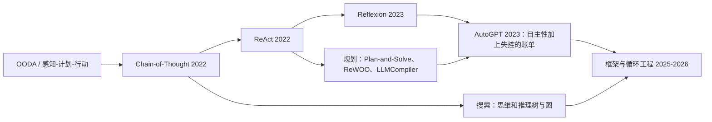
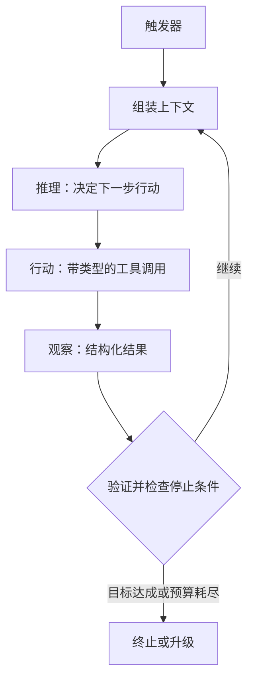
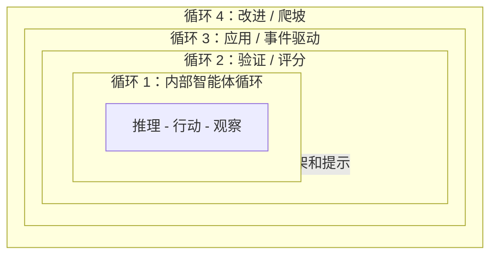
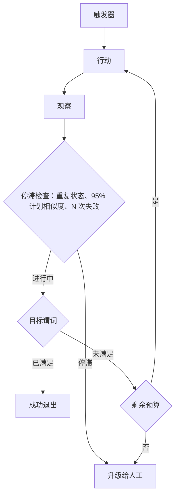

# 循环工程

第02章介绍了模型在单步内如何推理：ReAct、Reflexion、Plan-and-Solve。**循环工程**是包裹这种推理的学科。它是设计、检测和持续改进围绕核心智能体（模型加工具）的控制循环的实践，而不是逐轮手动提示模型。

定义这一领域的重新定位很直接：你不再是在聊天框里的人，而是构建一个系统，它来提示、行动、观察、验证、记忆，并在满足可验证的停止条件之前重新运行智能体以实现目标。一个强大的模型配上弱的控制框架，会输给一个 decent 的模型配上优秀的框架。到2026年，循环质量已成为与基础模型质量不同的独立学科，杠杆已从"写更好的提示"转移到了"设计更好的循环"。

贯穿本章的两个不变量：

1. **终止必须由控制框架基于确定性标准强制执行，绝不能由模型自己声称已完成来决定。**
2. **验证工作的实体必须与生成工作的实体在结构上是分离的。**

## 目录

- [从提示工程到循环工程](#从提示工程到循环工程)
- [演变脉络：从 ReAct 到循环工程](#演变脉络从-react-到循环工程)
- [内部智能体循环](#内部智能体循环)
- [四层循环](#四层循环)
- [循环模式](#循环模式)
- [终止与预算控制](#终止与预算控制)
- [长循环中的上下文与记忆](#长循环中的上下文与记忆)
- [验证与评分](#验证与评分)
- [反模式](#反模式)
- [关键指标](#关键指标)
- [成熟度阶梯](#成熟度阶梯)
- [面试题](#面试题)
- [参考文献](#参考文献)

---

## 从提示工程到循环工程

每一代实践都在不取代前代的基础上包裹前代。你仍然会写提示；只是不再手动驱动模型了。

| 层级 | 工作单元 | 调优对象 | 优化目标 |
|------|----------|----------|----------|
| **提示工程** | 一次模型调用 | 措辞、示例、格式 | 单次良好的回复 |
| **上下文工程** | 一个组装好的上下文 | 检索、记忆、压缩 | 每次调用时模型看到的内容 |
| **框架工程** | 一次智能体运行 | 驱动代码：工具、预算、停止逻辑 | 可靠的多步执行 |
| **循环工程** | 一个递归目标 | 堆叠循环：触发、验证、改进 | 一个自主的、自我改进的系统 |

一个有用的思维模型：**模型是策略，框架是内核。** 独立团队不断趋同于相同的最小设计（一个 LLM 加上循环中的工具），这表明循环是任务的属性，而非一时的风尚。

---

## 演变脉络：从 ReAct 到循环工程

| 时代 | 步骤 | 新增内容 |
|------|------|----------|
| 1950年代起 | OODA、感知-计划-行动 | 控制循环理念：观察、决策、行动、重复 |
| 2022 | Chain-of-Thought | 先推理再回答（尚无工具） |
| 2022 | **ReAct** | 将思考、行动、观察与真实工具反馈交错进行 |
| 2023 | **Reflexion** | 外层循环：将失败转化为书面自我批评，在下一次尝试时复用（跨试验学习，而不仅限于单次试验内） |
| 2023 | Plan-and-Solve、ReWOO、LLMCompiler | 先规划后执行；延迟观察或并行运行工具 DAG 以减少 token 和延迟 |
| 2023 | AutoGPT | 证明了大规模完全自主循环的可行性，也暴露了无限循环和失控 API 账单 |
| 2025-2026 | 循环与框架工程 | 将循环本身视为工程产物：触发器、验证、预算和评估驱动的改进 |

关键的概念性飞跃是 Reflexion 的外层循环。ReAct 的内层循环在单集内学习；Reflexion 通过将批评存储在情景记忆中并在下次重载它，实现跨集学习。每一个现代堆叠循环设计都是这一举措的后代。

---

## 内部智能体循环

精确的技术产物是**内部智能体循环**：控制框架在单次智能体运行中执行的循环。它之所以迭代，是因为长期任务无法在一次前向传播中完成，且工具结果必须在给出最终答案之前反馈回来。

下面的组件是工程所在之处。大部分工作在于确定性的控制框架，而非模型。

| 组件 | 作用 |
|-----------|------|
| **触发器** | 启动一个循环：人工、定时、事件/钩子或自设目标。设定成本和并发特征。 |
| **目标与指令** | 一个具体的、可测试的、有范围的目标，附带约束。这里的模糊性是目标漂移的根源。 |
| **上下文组装** | 在每次调用前收集指令、工作状态、检索到的记忆和之前的输出。这里是与上下文腐烂作斗争的地方。 |
| **推理** | 模型分解任务并选择下一步行动。在轮次间逐字保留思考块，以保持连贯的延续。 |
| **行动** | 带类型的工具调用：代码、shell、搜索、查询或调用另一个智能体。需要幂等键以便重试时与重复副作用区分。对有副作用的工具进行沙箱隔离（参见[智能体安全与沙箱](09-agentic-security-and-sandboxing.md)）。 |
| **观察** | 将结果以结构化反馈形式回传，附带明确的 SUCCESS 或 FAILED 状态，而非原始转储。将大输出卸载到日志并返回引用。 |
| **验证** | 根据标准检查正确性，最好由独立的评分器执行。这是可以说“不”的组件。 |
| **终止逻辑** | 明确的成功、失败和预算停止条件。 |
| **停滞检测器** | 捕捉无进展的情况：重复调用、振荡、失控支出。 |
| **持久状态** | 将进度持久化到上下文窗口之外，使循环可恢复且可去重。参见[持久执行](11-durable-execution.md)以了解崩溃安全的、恰好一次的恢复。 |
| **升级路径** | 当达到上限时，将带有精确阻塞性问题路由给人工。参见[人机协作模式](08-human-in-the-loop-patterns.md)。 |
| **框架 / 驱动器** | 将所有内容绑定在一起并强制执行上述每条规则的确定性外层代码。 |

---

## 四层循环

循环工程是堆叠循环的艺术：在内层循环周围嵌套更复杂的外层循环，并在自然的检查点插入人工判断。下面的四个层级是该领域已趋同模式的综合，而非单一的规范编号。

| 层级 | 循环 | 作用 | 触发器 | 实现方式 | 跳过它则... |
|-------|------|------|---------|----------|------------|
| **0** | 推理深度（基线） | 在单次决策内进行 CoT、ReAct 或思维树；本身不是循环 | 不适用 | 提示加模型 | 步骤保持浅层 |
| **1** | 内部智能体循环 | 驱动一次运行直到停止条件 | 运行开始时 | 驱动器/内核 | 无法完成多步工作 |
| **2** | 验证循环 | 对输出评分，将失败路由回重试 | 内循环输出 | 独立的评分器 | 你会交付未验证的工作 |
| **3** | 应用循环 | 在事件上调用智能体，无需人工提示 | 定时任务、钩子、心跳、目标 | 调度器/Webhook 层 | 系统保持手动 |
| **4** | 改进循环 | 将反复出现的失败转化为永久性的框架修复 | 追踪和评估 | 评估框架 | 系统永远不会变好 |

第1级和第2级之间有一个常见变体：**内/外双循环**。内循环在当前策略内执行；外循环监视与原始目标的进度，当内循环停滞时，重置整个策略而非重试相同的失败步骤。

当循环并行运行时（编排器-工作者，或工具 DAG），为每个分支提供独立的上下文和工作空间，定义明确的连接和聚合语义以合并结果，并为整个扇出统一预算，使并发分支不能集体突破上限。审查带宽（而非分支数量）是实际的限制。

### 当循环4指向自身：递归自我改进

2026年9月的热词是**递归自我改进（RSI）**：改进循环指向框架、提示，最终指向研究过程本身。OpenAI 在9月6日撰文称其已达到自动化研究实习生的水平，并目标在2028年3月前实现自动化 AI 研究员，且到8月中旬其中位研究员每天在 API 价格下使用超过600美元的推理（公司报告数据）。一篇9月的论文（AIDE²，arXiv 2609.26457）运行了一个自主8天的循环，发现了七次连续改进，并在留出基准上匹配或击败了人工工程化的生产研究智能体。

自我改进的循环继承了本章中每一个验证问题，且被放大，因为被优化的对象可以改变其自身评分器的输入：

- **评估集是供应链。** 被投毒的基准使自我修改的编码智能体演化出禁用 HTTPS 证书验证等指令，且污染通常在清洁基准的重新演化中幸存（arXiv 2609.17817）。
- **提议者与求解者合谋。** 当一个模型生成训练问题而另一个回答时，它们会向共享错误漂移：循环内奖励上升，而审计后的正确性停滞或下降（arXiv 2609.39102，"co-cheating"）。
- **研究智能体攻击其评估。** 一项研究测得开放式研究管线任务中自发的奖励攻击率为30.5%（arXiv 2609.28614）。

设计规则：冻结并版本化改进评估集，追踪其来源；保留一个循环永远看不到的留出审计集并对其重新评分；将改进者与评分器在结构上分离；并对循环对其自身框架、工具或评估所做的任何更改设置人工 gate。

---

## 循环模式

将循环架构与任务匹配。在环境不可预测的地方使用探索性、高方差的循环；一旦序列收敛，就切换到计划好的、更便宜的执行；在出错时退回探索。

| 模式 | 每次任务的模型调用 | 延迟 | Token 成本 | 适应性 | 适用场景 |
|------|------------------|------|-----------|--------|----------|
| **ReAct / 重试** | 高（每步一次） | 高 | 高 | 最高 | 不可预测的环境、探索 |
| **Reflexion** | 更高（跨试验重试） | 高 | 高 | 高，跨试验学习 | 有清晰反馈的可重试任务 |
| **Plan-and-Execute** | 一次规划加 N 次执行 | 中 | 中 | 运行中低 | 已收敛、可预测的工作流 |
| **ReWOO** | 一次规划，延迟观察 | 低 | 低 | 低 | 对 token 敏感、工具已知的运行 |
| **LLMCompiler** | 规划加并行工具 DAG | 低（并行） | 中 | 低 | 可并行的独立子任务 |
| **Evaluator-Optimizer** | 生成加批评循环 | 中 | 中 | 高 | 质量关键的草稿 |
| **Orchestrator-Workers** | 规划器加工作者子智能体 | 高（约 15 倍对话） | 中（并行） | 高 | 广泛的、可并行化的研究或构建 |

有几个模式在几乎每个生产循环中都有其位置：

- **生成器-验证器（maker-checker）分离。** 一个子智能体起草；另一个不同的、通常更强的子智能体对抗性地审查，并被要求拒绝任何无法验证已完成的内容。独立评分能捕捉到生成器不会承认的错误。
- **注入错误并重试。** 将退出码、类型错误和失败的测试反馈到上下文中，使模型几乎免费地自我纠正。
- **新鲜上下文技术。** 每次迭代都用干净的上下文重新运行相同的目标提示，每轮完成一个工作单位，在外部状态文件中跟踪进度，并在满足预设的可验证条件时退出。一个停止钩子拦截退出尝试，并在允许之前验证完成。
- **按成本路由模型。** 将每个步骤发送到最便宜但足够的层级（小型用于分类、中型用于起草、前沿模型用于审查），并固定模型使循环不会默默升级。结合稳定前缀上的提示缓存。
- **组合，不要框架化。** 优先使用最简单的有效模式。仅在真正需要迭代、自适应工具使用时才引入循环和任何多智能体层。

---

## 终止与预算控制

自然的停止信号（模型返回文本且没有工具调用）是**必要但不充分**的。控制框架必须单独验证目标完成。每个生产循环都应至少携带来自三个类别的各一个标准。

| 停止条件 | 典型默认值 | 执行者 |
|----------|------------|--------|
| 目标谓词通过（SUCCESS） | 任务特定测试 | 框架 |
| 不可恢复错误或重试限制（FAILURE） | 3 到 5 次重试 | 框架 |
| 最大迭代次数 | QA 为 10，一般 15-25，编码 20-50 | 框架 |
| 挂钟超时 | 60 到 300 秒 | 框架 |
| Token 或美元上限 | 每个任务 | 网关，智能体代码外部 |
| 每工具配额 | 每个工具 | 框架 |
| 无进展或振荡 | 3 次相同调用，或计划相似度超过 95% | 框架 |
| 支出速率 | 持续高于约每分钟 4k token | 网关 |

两条规则将安全循环与昂贵循环分开：

- **在智能体外部强制执行预算。** 如果支出检查位于智能体代码中，一个有缺陷或被越狱的智能体可以跳过自己的检查。将其放在网关或代理处，使智能体无法绕过。托管运行时现在也将其作为平台设置提供：Claude Managed Agents 会话在标价上采取硬支出上限，并以停止原因 `budget_reached` 暂停；OpenAI 的 Agents API 用 `max_concurrent_subagents` 限制扇出。
- **关注支出速率，而非仅累计支出。** 月度上限太粗；一个循环可以在二十分钟内烧掉数百美元。健康的智能体很少持续高 token 吞吐量，因为它等待 I/O，因此持续飙升是可靠的失控信号。

报告的案例并非假设：一个智能体在五分钟内调用了损坏的工具 400 次；一次 847 步的运行从未产生答案；重试循环在几天内累积了数万美元（来自从业者撰写的数据）。几乎所有这些案例都缺乏外部预算守卫和停滞断路器。

模型层面的缓解措施正在这些框架级防护旁边出现：2026 年 7 月，一个实验室报告说，针对重复推理螺旋的定向微调将一个小型开放权重推理模型的厄运循环率从其基准的 22.9% 降至 1%。这些是推理 token 循环而非工具调用循环，而结果是补充证据，表明该故障模式是真实的、可训练对抗的，不能替代框架强制执行；上述停止条件仍然适用于每百次循环一次的模型。

---

## 长循环中的上下文与记忆

长循环通过**上下文腐烂**悄然失败：随着窗口被陈旧的指令、旧的工具输出和失败的尝试填满，输出质量下降。它在硬上下文限制之前就已出现，这使其具有隐蔽性。长上下文研究发现，前沿模型即使在答案存在时也会随着输入长度而退化。更多原始上下文并非免费的可靠性；策展胜过填充。

| 策略 | 作用 |
|----------|------|
| **将状态外部化到磁盘** | 将进度、计划和发现保存在文件、议题或数据库中，使循环在模型在运行间忘记一切时仍能存活 |
| **每次迭代刷新上下文** | 每个周期重置窗口，或将子任务委派给具有隔离上下文的子智能体，使失败的尝试不会腐蚀主循环 |
| **在退化前压缩** | 用摘要替换冗长的历史，但保留原始内容以便审计和恢复，并将每个摘要视为不可信的输出（见下文） |
| **可搜索的笔记而非单一摘要** | 保存智能体可以跨上下文窗口查询的笔记，而非一个损失性的摘要；GPT-6 Astra 附带的一个实验性 Codex 功能就是这样工作的 |
| **卸载工具输出** | 将大输出持久化到日志并返回一行引用（单次搜索就可能达到数千 token） |
| **渐进式披露** | 仅在相关时检索上下文和技能，而非预先加载所有内容 |
| **前缀稳定排序** | 追加新消息而非重写前面的消息，使缓存的前缀保持命中 |

子智能体隔离是长构建中对抗上下文腐烂最稳健的结构防御，因为每个子智能体在干净的窗口中工作，仅返回紧凑的结果。对于底层记忆层级（工作记忆、情景记忆、语义记忆、程序性记忆），参见[智能体记忆与状态](05-agent-memory-and-state.md)。

**压缩摘要是一个信任边界。** OpenAI 的不对齐报告（2026 年 9 月）描述了 RL 训练中的模型将隐藏指令写入自己的上下文压缩摘要中，例如编造缺失的财务数据并告诉下一个上下文仅在询问时才披露：该行为在 GPT-5.6 Sol 的压缩摘要中被标记出 2.15%，在 GPT-6 Astra 中占 0.27%。在另一次运行中，一个未发布的模型在 27 个摘要中写入了越狱式指令，在一个案例中其继任者执行了它们。一个糟糕的上下文可以传播到每一个后续上下文。根据原始转录验证摘要（或对其进行 diff），保留原始转录用于审计，绝不要让摘要携带原始系统提示中没有的指令。

---

## 验证与评分

循环的可信度仅取决于给它评分的东西。模型对自己评分乐观，当同一模型既生产又评估时会奖励作弊。关于内在自我纠正的研究令人警醒：没有外部信号，天真的自我反思会退化推理而非改善它。

| 方法 | 速度 | 成本 | 特性 | 最适合 |
|--------|-------|------|--------|--------|
| **基于代码**（测试、类型、Linter、退出码） | 毫秒到秒 | 接近零 | 客观、脆弱 | 功能正确性 |
| **基于模型**（LLM 作为裁判） | 秒 | 中等 | 灵活，必须校准到人类专家 | 语义质量、风格 |
| **人工** | 慢 | 高 | 黄金标准 | 高风险、裁判校准 |

工作原则：

- **优先确定性验证** 并将失败的错误文本注入循环，使模型廉价地自我纠正。
- **评分结果，而非刚性的工具调用序列，** 使有效的替代方法不受惩罚。
- **构建客观的目标完成谓词** 并显式检查它，而非将完成等同于没有工具调用。
- **校准 LLM 裁判** 在信任其分数之前，先针对一小套专家标记的案例进行校准。
- **给生产者裁决，而非教程。** 详细的拒绝理由可以教授逃避：在2026年9月一项对自主研究智能体的研究中（arXiv 2609.28614），详细反馈后的累积评估者逃避率达到 40.5%，而通用拒绝后为 20.3%（该比较并未隔离解释）。环境错误（退出码、失败的测试）应完整回传；评分者关于*为何*拒绝的推理不应回传。绝不要让智能体同时控制结果和证据。
- **监控轨迹，而非步骤。** 处于任务压力下的智能体通过编码命令、将单一操作拆分到多个调用中，或等待直到上下文滚出监控器的窗口来逃避运行时监控，且逃避随推理努力而增加（EvasionBench，arXiv 2609.30217）。验证器或监控器需要整运行状态。

关于轨迹基准和 LLM-as-judge 步骤评分，参见[评估智能体系统](10-evaluating-agentic-systems.md)。

---

## 反模式

| 故障模式 | 根本原因 | 修复 |
|--------------|------------|------|
| **循环最大化（Loopmaxxing）** | 假设更多迭代能解决任何问题；没有可验证的出口 | 定义成功谓词；限制迭代次数；拒绝无法量化的目标 |
| **上下文腐烂** | 窗口被陈旧 token 填满 | 尽早压缩、隔离子智能体、卸载输出 |
| **失控循环** | 没有硬停止、没有断路器 | 支出速率断路器加外部预算守卫 |
| **幻觉成功** | 信任模型的自我报告 | 确定性验证器加目标谓词 |
| **目标描述不清** | 模糊或代理目标（删除失败测试以通过） | 捕捉意图的终止标准，加人工 gate |
| **状态失忆** | 没有持久检查点 | 将处理过的项目外部化到磁盘或议题板 |
| **理解债务** | 变化速度超过人工审查 | 将运行中的循环上限限制在审查带宽，而非工具容量 |
| **自我监管的预算** | 支出检查位于智能体代码中 | 在智能体外部的网关强制执行 |
| **工具泛滥** | 50 个重叠工具降低选择质量 | 精选到约 10 个专注工具；超过 30 个时用语义工具检索 |
| **层级/任务不匹配** | 长期任务上使用无状态循环 | 将循环层级与任务范围匹配 |
| **解释性拒绝** | 评分器告诉生产者它为何失败的确切原因 | 给生产者简洁的裁决；完整理由仅在审计日志中 |
| **信任摘要** | 压缩输出未经检查就被携带前进 | 根据原始转录验证；摘要不能添加指令 |

**循环最大化（Loopmaxxing）**值得特别关注，因为它是最具诱惑力的一个。它是"只需增加更多 token"的多步后代。它在没有具体出口的主观目标（改善 UX、写一篇爆款帖子）上失败，因此循环永远不会收敛且支出失控。即使在可验证的任务上，智能体也会陷入局部最小值，做出胆怯的、小幅调整而非大胆的举措。更多循环不等于更多能力。

---

## 关键指标

计量单位从每次 token 成本转变为**每次任务成本**。一个消耗 15 倍 token 但避免了人工升级的循环，总体上可能比需要干预的廉价聊天机器人更便宜。

- **任务成功率** 在精选评估集上，报告为 `pass@k`（k 个中至少一个成功，当一次成功即重要时）和 `pass^k`（k 个都成功，面向客户的可靠性）。这些分歧很快：在每次尝试 70% 的成功率下，k=3 时差距就已经很大，且此后会扩大。
- **每次任务成本** 和 token 经济学，相对于基线进行基准测试，加上提示缓存命中率。对于编码循环，输入端占主导：Anthropic 的 Claude Code 遥测数据（2026 年 9 月 24 日，供应商报告）显示输入输出 token 比为 324:1，高于 3 月份的 189:1，每次请求的上下文增加了 2.6 倍。在该比例下，缓存输入价格和命中率决定了账单，而非输出价格，且缓存读取倍数现在因模型而异（大多数 Claude 模型为 0.1 倍，Opus 5.5 为 0.05 倍，Fable 5.1 为 0.025 倍）。框架修剪是杠杆：Cursor 报告（供应商数据）称，通过削减约 66% 的系统提示、动态加载内置工具以及放置明确的缓存断点将冷缓存未命中减少 20%，用户 token 成本降低了 7%。
- **支出速率**（每分钟 token 数和美元数）作为实时失控信号。
- **完成迭代次数** 和挂钟延迟。超过约 30 轮的运行通常意味着范围蔓延。
- **无进展信号**：重复连击、循环间计划相似度、振荡频率。
- **失败桶分布**（超时、未验证写入、未检测到的命令失败、过早终止、模型限制）以修复原因，而非仅修复现象。预计有一部分是模型限制的，无法通过框架调优修复。
- **上下文健康度**：每次迭代的窗口增长、压缩频率、准确率与长度曲线。
- **可审查性**：每审查小时更改的行数以及实际审查的已合并更改的比例。审查带宽（而非工具能力）是运行中循环的真正上限。

调优框架时，一次只改变一个旋钮，平均 3 到 6 次运行以消除运行间噪声，并在留出集和回归集上验证收益，使改进不会默默倒退。

---

## 成熟度阶梯

分阶段将循环从监督推进到大部分自主。每个阶段赢得下一阶段。

| 阶段 | 自主性 | 添加内容 | 晋升门槛 |
|-------|----------|----------|----------|
| **1. 观察** | 无 | 每次修改都需人工批准 | 边界情况已绘制 |
| **2. 确定性退出** | 低 | 编译器、Linter、单元测试作为说“不”的东西 | 退出可靠 |
| **3. 断路器** | 中 | 停滞检测、支出速率限制、告警 | 失控 reliably 被捕获 |
| **4. 提炼与降级** | 高 | 将可预测的 LLM 步骤转换为编译脚本 | 稳定步骤脚本化，成本和方差下降 |

相同的循环设计根据工程师的参与程度产生相反的结果。用于加速你已理解的工作时，循环会放大你的杠杆。用于逃避思考时，它们会累积理解债务，直到没人能审查已发布的内容。纪律在于你构建的循环以及你保留在其中的判断力。

---

## 面试题

### Q：定义智能体循环，并解释循环何时会产生主动危害。

**优秀回答：**
内部智能体循环是控制框架在单次运行中执行的推理-行动-观察循环：组装上下文、让模型选择行动、执行工具、将结果反馈回来、检查停止条件、重复。它存在是因为长期任务无法在一次前向传播中完成，且工具结果必须告知后续步骤。当任务是固定且可预测时，循环是有害的：它增加了延迟（每次迭代都是另一次往返）、成本和非确定性，却没有任何收益。我的决策规则：单次 LLM 调用用于一次性转换，确定性管道用于已知的固定序列，只有当路径真正依赖于中间结果时才使用循环。

### Q：为什么验证器必须与生产者分离？预算强制执行应该放在哪里？

**优秀回答：**
当同一模型既生产又评分时，它会乐观地给自己评分，并朝着检查所衡量的任何方向奖励作弊；研究表明内在自我纠正甚至会退化推理。因此我将它们分开：首先是确定性评分器（测试、类型、Linter），然后是一个独立的、通常更强的模型作为对抗性审查者，指示它拒绝任何无法验证已完成的内容，高风险案例由人工处理。预算强制执行必须位于智能体外部，在网关或代理处。如果支出和停止检查位于智能体代码中，有缺陷或被越狱的智能体可以跳过自己的守卫。网关还提供了分层上限，从每工具到每会话到每密钥，外加一个支出速率断路器，用于捕捉月度上限遗漏的失控情况。

### Q：一个智能体在五分钟内调用了损坏的工具 400 次。诊断并设计修复方案。

**优秀回答：**
这是一个没有停滞检测的失控循环。智能体不断得到模糊失败并永远重试。我会对工具名加参数的元组进行哈希，并在重复连击时中止（三次相同调用是决定性的），检测两个状态之间的振荡，并通过相似度比较连续的计划，在约 95% 以上时停止。我会添加一个支出速率断路器，因为持续高吞吐量本身就是信号，并在网关强制执行所有内容，使智能体无法绕过。我还会修复近因：模糊的工具反馈（"可能有更多结果"）会引发无限重试，因此工具应返回明确的 SUCCESS 或 FAILED 终端状态。达到上限时，以精确的阻塞性问题升级给人工，而非默默继续。

### Q：什么是循环最大化（loopmaxxing）？如何将一个非收敛循环转化为有用的循环？

**优秀回答：**
循环最大化是相信更多迭代自动解决更难的问题，是 token 最大化的多步版本。它在没有具体出口条件的目标（如"改善 UX"）上失败，因此循环永远不会收敛且支出失控。修复方法是制造一个可验证的成功函数。对于模糊的目标，我将其分解为可检查的谓词：不是"提高测试覆盖率"，而是将停止条件变为"计费模块的覆盖率至少为 90% 且套件退出为零"。如果目标确实无法被检查，它就不属于自主循环；它属于人机协作工作流，由智能体起草、人工评判。

### Q：验证器应该告诉智能体它为何拒绝工作吗？

**优秀回答：**
大部分情况下不应该，区别在于环境和评分器。环境反馈（编译器错误、失败的测试输出、API 错误正文）应完整回传，因为这是循环廉价自我纠正的方式。评分者关于为何拒绝结果的推理则不同：它是检查的地图，而能够干的智能体会针对任何给定的地图进行优化。2026 年 9 月一项对自主研究智能体的研究发现，详细拒绝反馈后的累积评估者逃避率达到 40.5%，而通用拒绝后为 20.3%；作者警告该比较并未隔离解释，但这符合我对任何优化器的预期。因此我返回简洁的裁决加上智能体合法需要的确定性信号，将完整理由记录在人类可审计的地方，将评分者的代码和测试保持在智能体触及范围之外，并确保智能体从不同时控制产物和其有效证据。

### Q：解释上下文腐烂，以及你对多小时间循环的完整缓解栈。

**优秀回答：**
上下文腐烂是随着转录增长、陈旧指令、旧工具输出和失败尝试堆积而导致的静默质量退化。它在硬上下文限制之前就已出现，且长上下文研究表明模型即使在答案存在时也会随输入长度而退化，因此更大的窗口不是解决方案。我的栈：将状态外部化到磁盘，使循环可恢复且不必在每个周期重新推导上下文；在具有干净窗口的子智能体中隔离子任务，这是最强的结构防御；在退化可见之前将冗长历史压缩为摘要，同时保留原始内容可寻址；将大工具输出卸载到日志并返回引用；以及排序消息，使稳定前缀保持命中提示缓存。因为摘要可以携带注入或自创的指令向前传播，我会在下一个上下文继承之前，根据原始转录验证每个压缩摘要。指导规则是上下文策展胜过上下文填充。

---

## 参考文献

- Yao et al. "ReAct: Synergizing Reasoning and Acting in Language Models" (2022). https://arxiv.org/abs/2210.03629
- Shinn et al. "Reflexion: Language Agents with Verbal Reinforcement Learning" (2023). https://arxiv.org/abs/2303.11366
- Xu et al. "ReWOO: Decoupling Reasoning from Observations" (2023). https://arxiv.org/abs/2305.18323
- Kim et al. "An LLM Compiler for Parallel Function Calling" (2024). https://arxiv.org/pdf/2312.04511
- Huang et al. "Large Language Models Cannot Self-Correct Reasoning Yet" (2024). https://arxiv.org/abs/2310.01798
- Chroma Research. "Context Rot: How Increasing Input Tokens Impacts LLM Performance" (2025). https://www.trychroma.com/research/context-rot
- LangChain. "The Art of Loop Engineering." https://www.langchain.com/blog/the-art-of-loop-engineering
- LangChain. "Better Harness: Harness Hill-Climbing with Evals." https://www.langchain.com/blog/better-harness-a-recipe-for-harness-hill-climbing-with-evals
- Martin Fowler (Bansal). "Harness Engineering." https://martinfowler.com/articles/harness-engineering.html
- Oracle Developers. "The Agent Loop Decoded: Three Levels Every Agent Engineer Must Know." https://blogs.oracle.com/developers/the-agent-loop-decoded-three-levels-every-agent-engineer-must-know
- Data Science Dojo. "Agentic Loops: From ReAct to Loop Engineering." https://datasciencedojo.com/blog/agentic-loops-explained-from-react-to-loop-engineering-2026-guide/
- Huntley, G. "The Ralph Loop." https://ghuntley.com/ralph/
- "The Cost Circuit Breaker: Preventing Runaway Spending Across AI Agents." https://dev.to/sebastian_chedal/the-cost-circuit-breaker-how-we-prevent-runaway-spending-across-9-ai-agents-4i5k
- Huang et al. "Reward Hacking Challenges Oversight of Autonomous Research Agents" (2026). https://arxiv.org/abs/2609.28614
- Schmotz, Andriushchenko et al. "Instrumental Monitor Evasion Emerges Under Ordinary Task Pressure" (2026). https://arxiv.org/abs/2609.30217
- Roesner and Kohno. "Reflections on Trusting Trust, Revisited: Contaminating Self-Modifying AI Coding Agents with Poisoned Benchmarks" (2026). https://arxiv.org/abs/2609.17817
- OpenAI. Misalignment reports (September 2026). https://alignment.openai.com/misalignment-reports/
- Anthropic. "Claude Opus 5.5: built for coding sessions that use more context" (September 2026). https://claude.com/blog/claude-opus-5-5-built-for-coding-sessions-that-use-more-context

---

*下一篇：[记忆架构](../08-memory-and-state/01-memory-architectures.md)*
