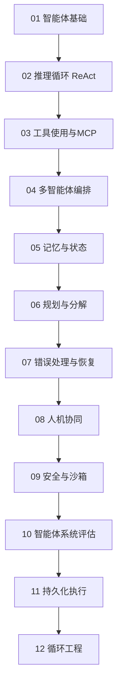
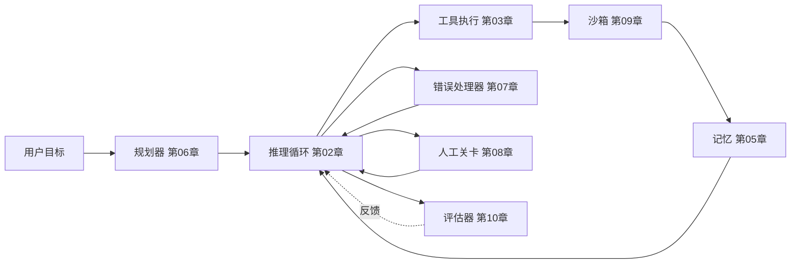

# 智能体系统

2026年构建生产级AI智能体：推理循环、MCP工具使用、多智能体编排、记忆、规划、错误恢复、人机协同与评估。

智能体并非单一技术，而是由推理循环、工具层、记忆、规划器、错误处理器和评估器组成的复合体。本文件夹中的12个章节深入探讨每一层，前面的章节为后面建立术语基础。

## 章节顺序

## 参考架构

每个章节的概念对应已部署智能体的一个组件。下图展示了各章节内容在生产系统中的位置：

## 本文件夹文件列表

| 文件 | 内容 |
|------|----------------|
| [01-agent-fundamentals.md](01-agent-fundamentals.md) | 什么使一个系统成为"智能体"；智能体与工作流的区别；何时选择哪种。 |
| [02-reasoning-loops-react-and-beyond.md](02-reasoning-loops-react-and-beyond.md) | ReAct、计划与执行、反思、思维树；循环设计模式。 |
| [03-tool-use-and-mcp.md](03-tool-use-and-mcp.md) | 函数调用、模型上下文协议（MCP）、2026-07-28无状态重写及2026年8月路线图、技能扩展、A2A v1.0、智能体商业协议、MCP生产加固（咨询浪潮、OAuth混淆）、计算机使用工具集。 |
| [04-multi-agent-orchestration.md](04-multi-agent-orchestration.md) | 多智能体何时有用、何时有害；监督者、群体、流水线（代码即工作流）和辩论模式；托管协调器。 |
| [05-agent-memory-and-state.md](05-agent-memory-and-state.md) | L1-L4记忆层级（工作记忆、情景记忆、语义记忆、程序记忆）及权衡；写入时、睡眠时与读取时策展；何时记忆会使智能体变差。 |
| [06-planning-and-decomposition.md](06-planning-and-decomposition.md) | 任务分解、需求提取、计划修订、长时程规划。 |
| [07-error-handling-and-recovery.md](07-error-handling-and-recovery.md) | 工具故障、重试、循环守卫、终止开关与遏制时间、跨供应商回退。 |
| [08-human-in-the-loop-patterns.md](08-human-in-the-loop-patterns.md) | 确认关卡、策略门控自主性、批准洗白、升级、监督自主性。 |
| [09-agentic-security-and-sandboxing.md](09-agentic-security-and-sandboxing.md) | 代码执行沙箱、能力门控、智能体中的提示注入、2026年事件记录、带外遏制。 |
| [10-evaluating-agentic-systems.md](10-evaluating-agentic-systems.md) | 轨迹评估、当前智能体基准及其报告陷阱、评估完整性、决策模型评判器。 |
| [11-durable-execution.md](11-durable-execution.md) | 长时程智能体的崩溃存活：事件历史、重放、精确一次副作用、Temporal和托管智能体运行时。 |
| [12-loop-engineering.md](12-loop-engineering.md) | 围绕智能体的循环工程：四个循环层级、递归自我改进、终止与预算控制、上下文衰减、验证、反模式（如循环最大化）及成熟度阶梯。 |

## 配套章节

- [工具使用与计算机智能体](../17-tool-use-and-computer-agents/) 扩展了本节内容，涵盖OpenClaw、计算机使用及工具智能体全景。
- [LangGraph编排](../09-frameworks-and-tools/02-langgraph-orchestration.md) 是本节模式最常见的实现框架。
- [智能体RAG](../06-retrieval-systems/08-agentic-rag.md) 探讨智能体与检索的交叉领域。
- [可靠性与安全](../13-reliability-and-safety/) 将智能体安全扩展到第09章沙箱之外的领域。

## 关键要点

- 智能体并非单一技术；它们由推理循环、工具层、记忆、规划器和评估器组成。请先阅读第01章。
- MCP是2026年的标准工具互操作协议（当前规范版本2026-07-28，与A2A共同由Agentic AI Foundation管理）；除非有充分理由，否则不要构建自定义工具协议。
- 多智能体编排（第04章）被过度应用；对于大多数用例，配备良好工具的单智能体优于多智能体。
- 记忆（第05章）和错误恢复（第07章）是大多数生产级智能体错误的根源；请将评估预算重点投入这些领域。
- 人机协同（第08章）不是后备方案；对于高风险操作，请有意设计关卡。批准和权限分类器可以降低风险，但遏制（沙箱、出站策略、带外终止路径）才是边界（第09章）。
- 循环工程（第12章）现已成为一门独立学科：强大模型配弱框架，不如普通模型配好框架。在框架中强制终止和预算，并保持验证器与生产者分离。
